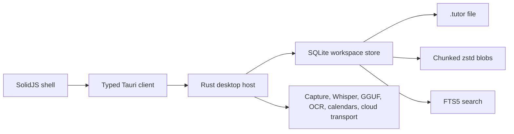

# Tutorux: rewrite the C++/Slint app into a SQLite desktop workspace

> Complete branch-level description for `tauri-rewrite`. This document covers everything added, changed, moved, or retired since branching from `main`, not only the final SQLite feature pass. The branch contains a large intermediate TypeScript/`.tux` implementation that was later replaced; this description records that history so reviewers can understand the final tree and the reasons for the churn.

## At a glance

| Item | Value |
| --- | --- |
| Base | `main` at `7fbbe9e6bc58ef024eb8da5ccae05166fc62936e` |
| Branch | `tauri-rewrite` |
| Final shape | Desktop-first SolidJS + Tauri 2 + Rust + SQLite application |
| Workspace | One portable `.tutor` SQLite database |
| Branch size | 3,657 commits; 1,305 files; +339,907 / −115,840 lines at the final code snapshot |
| Final target | Windows, macOS, and Linux desktop |
| Removed targets | C++/Slint app, custom `.tux` engine, browser edition, CLI, console, audio-helper binary |
| Release artifacts | MSI, NSIS setup, portable EXE |
| Verification | TypeScript checks, Rust checks, 71 Rust tests, 12 frontend tests, packaged smoke test, real Whisper and OCR fixtures |
| External qualification | Live OAuth/CalDAV, live cloud AI, local GGUF, mobile hardware, 100 GB workload, corrupt-database salvage |

The final product is not a polish pass on the old application. It is a full replacement of the application architecture, the persistence format, the desktop host, the UI shell, the feature navigation, the AI boundary, the capture stack, the packaging pipeline, and most of the test strategy.

## What existed on `main`

`main` is a C++23 and Slint desktop application. The application is a local-first tutoring workstation that records lessons, organizes notes and materials, builds evidence-linked study guides, and keeps student records inside one portable `.tux` archive.

The baseline includes:

- a C++23 application and Slint UI;
- CMake presets, static runtime packaging, CMake modules for dependency licenses, FFmpeg patches, fonts, icons, and macOS app packaging;
- a custom `.tux` archive format with a v1 header, frames, record payloads, B+ tree index, commit locator, secondary indexes, compression, and encrypted envelopes;
- student profiles, sessions, notebooks, journal entries, transcripts, materials, evidence, study guides, templates, Trash, archive maintenance, session packages, and sanitized copies;
- recording with microphone and synchronized system tracks, track management, mixdowns, waveform playback, WAV import/export, interrupted-capture recovery, and local Whisper transcription;
- evidence extraction, source inspection, contradiction relationships, and evidence-linked guide generation;
- PDF/DOCX/HTML/Markdown/Word guide export and template management;
- AI handoff packages, external response import, OpenAI-compatible providers, native Anthropic/Gemini/Cohere/Perplexity protocols, Ollama, llama.cpp server, and optional embedded llama.cpp;
- a static web prototype/WASM path and a Windows portable executable;
- CMake/CTest tests, release qualification workflows, dependency-pin monitoring, Windows CI, and static-license collection.

The branch therefore starts with an application that is already substantial. The PR is large because it rewrites that application twice: first into a shared TypeScript/SolidJS/Tauri codebase, then into the final Rust/SQLite desktop architecture.

### Where the branch's commits went

The repository uses a one-file-per-commit style for much of the migration, so raw commit counts overstate the number of independent changes. The largest conventional-commit groups are:

| Scope group | Approx. commits | What it represents |
| --- | --: | --- |
| `feat(cli)` | 257 | CLI command surface, native capture, AI/diagnostics, parity |
| `refactor(rust)` | 225 | Rust module restructuring and removal of retired archive/CLI code |
| `test` (unscoped) | 216 | Domain, archive, UI, and parity tests |
| `chore(repo)` | 212 | Legacy C++/Slint/web removal and generated-file cleanup |
| `docs` (unscoped) | 158 | README, architecture, verification, migration docs |
| `refactor(frontend)` | 104 | Frontend module extraction and Tailwind conversion |
| `docs(migration)` | 103 | Feature-by-feature parity ledger |
| `feat(core)` | 80 | Shared archive/domain engines |
| `feat(ai)` | 69 | Provider, request, credential, package, response work |
| `build` (unscoped) | 69 | pnpm, Vite, Tauri, CI, release, and formatting setup |
| `refactor(cli)` | 66 | CLI module extraction |
| `fix(cli)` | 58 | CLI contract and parity fixes |
| `feat(archive)` | 56 | `.tux` format, encryption, recovery, compaction, repair |
| `chore` (unscoped) | 56 | Repo cleanup |
| `feat(desktop)` | 55 | Tauri host, launch, identity, packaging, native services |
| `test(e2e)` | 47 | Browser workflow coverage |
| `feat(audio)` | 46 | Capture, playback, mixing, tracks, waveform work |
| `test(parity)` | 43 | Golden CLI/archive corpus |
| `docs(readme)` | 37 | User-facing workflow docs |
| `refactor(ui)` / `feat(ui)` | 36 / 35 | UI structure and screens |
| `feat(frontend)` | 32 | SolidJS page implementations |
| Other scopes | remainder | store, OCR, calendar, reminders, material, evidence, guides, security, accessibility, performance |

These are scope labels, not disjoint subsystems; a single feature area often spans `feat`, `test`, `style`, and `docs` commits.

## Why the branch took three phases

The work did not move directly from C++/Slint to SQLite. The branch records three phases:

### Phase 1: port the C++/Slint application into TypeScript, SolidJS, and Tauri

The first phase preserves the existing `.tux` product while replacing the implementation:

- C++ business logic moves to a shared TypeScript domain layer;
- Slint screens move to SolidJS;
- the custom archive format moves to a TypeScript archive engine plus a Rust CLI/archive core;
- the desktop shell becomes Tauri 2;
- the browser build and desktop build share the same archive and domain rules;
- a standalone CLI is ported for automation and parity;
- the old C++/Slint/web prototype is removed after parity is established.

This phase produces a complete `.tux` application with browser/desktop/CLI adapters, encrypted archive editing, archive maintenance, rich capture, evidence graphs, guide generation, AI review/transport, and a large parity/regression test suite.

### Phase 2: replace the `.tux` architecture with SQLite

The intermediate TypeScript application exposes structural problems:

- the custom archive format is coupled to a large orchestration layer;
- normal edits write archive generations rather than incremental rows;
- the TypeScript archive engine and the Rust CLI duplicate persistence behavior;
- browser and desktop adapters impose different storage and native-capability constraints;
- entity-list navigation forces users to leave a session to reach its transcript, observations, materials, or guide;
- the archive lock, generation recovery, index rebuild, and encryption surfaces add complexity that a SQLite store already solves.

Phase 2 therefore removes the custom archive engine and the browser/CLI/console surface and rebuilds the product around:

- one `.tutor` SQLite file per workspace;
- one Rust workspace store;
- one typed Tauri command boundary;
- one desktop UI;
- FTS5 search;
- incremental transactions;
- SQLCipher encryption;
- chunked, content-addressed media.

Phase 2 also replaces the entity-list UI with task- and entity-centric navigation: Today, Students, Sessions, Schedule, Materials, Guides, Evidence, Assistant, Archive, and Settings. The session becomes the main workspace with Overview, Capture, Transcript, Notes, Materials, Evidence, and Guide tabs.

### Phase 3: complete the remaining desktop features

The final phase adds the features that the SQLite rewrite still lacked:

- evidence links and an evidence graph;
- archive compaction, reindexing, recovery copies, and sanitized copies;
- portable session packages;
- separate microphone/system tracks and a local mixer;
- file-based audio attachment for mobile or unavailable microphones;
- desktop reminders;
- local image OCR;
- Google/Microsoft OAuth and Apple CalDAV calendar integration;
- real Whisper speech qualification;
- real OCR qualification;
- a 1 GiB synthetic workspace qualification;
- expanded packaged smoke tests.

## Phase 1 in detail: the TypeScript/SolidJS/Tauri `.tux` application

The first phase is the largest part of the branch by commit count. It is no longer in the final tree, but its features and lessons shape the final product. This section records what was built and then retired.

### Toolchain and project structure

- Replaced the C++/CMake development path with pnpm, strict TypeScript 6.0.3, Vite, SolidJS, Tauri 2, ESLint, oxfmt, Vitest, Playwright, and cross-platform CI.
- Added the `frontend/` tree with `api`, `app`, `archive`, `ai`, `audio`, `domain`, `platform`, `features`, and shared design-system modules.
- Added the `cli/` tree and a shared archive/domain layer for command-line parity.
- Added Rust `src-tauri` modules for the Tauri host, native file access, audio capture, archive lock, credential vault, transcription, embedded AI, and diagnostics.
- Added package scripts for development, typechecking, linting, formatting, unit tests, coverage, browser E2E tests, archive benchmarks, browser builds, desktop builds, and release collection.
- Added strict typing for archive records, domain DTOs, platform capabilities, AI requests/responses, and CLI JSON contracts.
- Added a deterministic formatting/linting baseline and formatting-only commits for the new TypeScript surface.

### Shared domain layer

The TypeScript domain layer ports the C++ business rules, including:

- students, sessions, journals, notes, annotations, observations, transcripts, materials, evidence, guides, templates, settings, and Trash;
- session lifecycles, duplication, archiving, grouped deletion, journal linking, and note updates;
- student progress, goals, skill ratings, and profile revisions;
- transcript import, cue editing, timestamp handling, speaker labels, verification, split/merge, revision history, and restore;
- evidence creation, approval, rejection, source provenance, contradiction relationships, and review reset;
- guide generation, source citations, regeneration, approval, stale-source tracking, revisions, and export;
- material import, content-addressed chunks, extraction, metadata revisions, linking, and Trash;
- annotation, asset, recording, waveform, template, and WAV validation;
- archive settings, credential policy, and privacy classification.

### `.tux` archive v1 engine

The TypeScript engine supports the existing v1 archive wire format:

- header, frame, payload, commit, locator, primary B+ tree index, and secondary indexes;
- checksum validation and bounded length checks;
- LZ4 compression with C++-compatible hash/savings rules;
- C++-compatible encrypted envelopes and authentication;
- legacy fixtures for byte-level and cross-implementation compatibility;
- streams and bounded asset ranges instead of loading whole archives;
- archive identity, file identity, lock files, save conflict detection, and atomic replacement;
- revision history, published generations, historical verification, and commit-chain traversal;
- preview-first recovery, compaction, repair, index backfill, and pruning;
- sanitized copies with reviewed filters, staging, verification, and atomic publication;
- session packages with linked records and ID remapping;
- encrypted create, unlock, append, re-key, sanitized copies, recovery, and maintenance.

The archive tests include round trips, fuzzing/edge cases, encrypted fixtures, crash tails, damaged headers, repaired copies, compaction, pruning, streaming chunks, and legacy C++ compatibility.

### CLI

A standalone CLI was built and expanded across the phase:

- archive discovery, initialization, verification, recovery, compaction, repair, backup, encryption, rotation, sanitization, and settings;
- students, sessions, journals, notes, annotations, transcripts, materials/assets, evidence, guides, templates, progress, and Trash;
- import/export of transcripts, materials, guides, session packages, AI packages, and PDFs;
- encrypted archive reads and writes using passphrase environment variables;
- native audio capture, device probing, playback, mixing, waveform indexing, and Whisper;
- AI provider catalogs, request previews, provider execution, diagnostics, benchmarks, and embedded-model operations;
- guarded destructive operations with preview tokens and confirmation;
- JSON output contracts and parity fixtures for the legacy CLI.

The CLI eventually became a Rust binary sharing the Rust archive core rather than a TypeScript-only adapter.

### SolidJS application

The browser/desktop UI includes:

- a workspace shell with session navigator, notebook, transcript review, study guide editor, materials, students, evidence, settings, Trash, and a command palette;
- session workspace with recording, notebook, transcript, materials, evidence, and guide surfaces;
- a record workspace with consent, microphone/system tracks, take management, playback, waveforms, mixing, and transcription previews;
- a document editor with typed blocks, rich text operations, undo/redo, find/replace, split/merge, piece-table editing, autosave, and export;
- evidence maps, contradiction links, source inspection, and proof workflows;
- guide templates, cited generation, regeneration, revision comparison, and multiple export formats;
- AI package review, provider setup, credential storage selection, exact request previews, response review, vision attachments, and guide draft persistence;
- responsive layouts, dark/light themes, keyboard shortcuts, accessible controls, reduced motion, and mobile usability checks;
- empty states, loading states, error recovery, and conflict/save feedback.

### AI in the intermediate application

The intermediate AI stack includes:

- privacy-aware handoff packages and multipart context exports;
- OpenAI-compatible providers;
- native Anthropic, Gemini, Cohere, and Perplexity protocols;
- Ollama and llama.cpp server discovery;
- optional embedded llama.cpp with user-supplied GGUF models;
- provider catalog caching, model metadata, structured output, attachments, and vision manifests;
- reviewed requests with endpoint/body hashes, bounded responses, streaming, cancellation, partial-output retention, and error metadata;
- OS keychain and encrypted-archive credential storage;
- external response import and reviewed guide drafts;
- diagnostics and benchmarks.

Most of this survives conceptually in Phase 3, but the final UI keeps a smaller, reviewed cloud transport plus local GGUF and Whisper/OCR paths.

### Native desktop work in Phase 1

- Tauri single-instance handling and `.tux` launch handoff;
- native dialogs, save identity, file-change detection, and conflict protection;
- native OS credential vault commands;
- microphone capture and device selection;
- synchronized microphone/system capture primitives;
- process metrics and diagnostics;
- embedded Whisper and single-process GGUF inference;
- portable packaging, embedded runtime assets, and Windows GUI launch behavior;
- cross-platform CI, signing hooks, dependency scanning, and release qualification.

### Phase 1 archive compatibility details

The intermediate archive engine was not a stub. It handled the real v1 wire format and the operational surface around it:

- fixed magic/version/header fields and bounded record lengths;
- frame headers and CRC-32 integrity, including incremental checksums;
- LZ4 block encoding with C++-compatible hash and savings rules;
- primary B+ tree index pages and secondary indexes;
- published generations, commit locator, retained history, and generation-chain verification;
- encrypted index, manifest, and record envelopes;
- Argon2-based key derivation and libsodium-backed authenticated encryption;
- worker-owned key material and zeroization;
- archive identity, file identity, and OS-level archive locks;
- staged/atomic writes and conflict detection when another process changes the file;
- read-only unlock mode and authenticated append edits;
- encrypted create, unlock, append, re-key, sanitized copies, repair, recovery, compaction, and pruning;
- header/magic repair and recovery from checksum-damaged metadata;
- recovery of complete unpublished generations and consecutive generation tails;
- streaming asset ranges, chunked asset imports, verified exports, and bounded document extraction;
- session-package manifests and import/export with linked-record remapping;
- cross-implementation fixtures from the C++ implementation, including encrypted archives.

The archive phase also carried a detailed compatibility ledger and benchmark suite. The archive engine was later retired because custom generation writes, index rebuilds, and dual TypeScript/Rust persistence were more complexity than the product needed.

### Phase 1 CLI surface

The CLI grew from a port of the existing command workflow into a full automation surface. It shared archive and domain rules and produced JSON/readable output for scripts and parity tests.

Command groups included:

- `archive`: discover, init, verify, backup/copy, recover, compact, repair, encrypt, change-passphrase, sanitize, rename, settings, trash purge;
- `student`: list/show/create/update/progress/history;
- `session`: list/show/create/update/clone/archive/trash/restore/move/lifecycle/dates;
- `journal`: list/show/create/update/delete/relations, document text, revision history;
- `transcript`: import/generate/list/edit/split/merge/verify/export/history/restore;
- `asset`/`material`: import, stream, verify, metadata revisions, link/unlink, trash/restore, document text, PDF extraction;
- `evidence`: extract, create/update/delete, approve/reject, graph, source inspection, relationship restore;
- `guide`: create/get/update/regenerate/validate/export/templates/PDF/Word/HTML/JSON;
- `record`: devices, probe, start/stop, pause/resume, takes, tracks, mix, play, waveform index, import/export, Whisper;
- `ai`: providers, catalogs, models, requests, package export, response import, generate, embedded GGUF, diagnostics, benchmarks;
- `settings` and `templates`: archive settings, credential policy, template overrides/imports.

The CLI supported passphrase environment variables, consent metadata, preview-token confirmation for destructive actions, cancellation checks, bounded streaming, and atomic export replacement. It was retired in the final phase along with the archive engine.

### Phase 1 UI surface

The intermediate SolidJS app covered more surface than the final SQLite app, including several features that were later simplified or removed as part of the desktop-only product decision:

- workspace/session navigator, notebook, transcript review, record workspace, materials, students, evidence, study guides, AI workspace, Trash, settings, command palette, and archive picker;
- typed note blocks, rich text formatting, undo/redo, find/replace, split/merge, piece-table editing, autosave, document export, and print layouts;
- recording takes, track rename/trash/restore, synchronized microphone/system capture, pause/resume, waveform indexes, seekable playback, timestamp playback, and mixdowns;
- session and student revision history, restore flows, relation management, and citation-aware moves;
- evidence editing, contradiction/subsumption relationships, deterministic graph layout, source inspection, and transcript/material provenance;
- guide templates, cited generation, regeneration, revision comparison, source checks, PDF/Word/HTML/JSON/Markdown/text export, and embedded-image/table handling;
- AI package review, provider setup, credential vault selection, exact request previews, provider execution, response/error review, vision attachments, guide drafts, and external response import;
- responsive layouts, dark/light themes, compact/mobile navigation, keyboard shortcuts, reduced motion, focus states, and accessible control labels.

Some of that surface is intentionally absent from the final desktop product. The final tree keeps the workflows that fit the single-tutor desktop model and removes the browser/CLI/console-specific complexity.

### Phase 1 AI surface

The intermediate AI stack included:

- privacy-aware handoff packages and multipart context exports for external agents;
- OpenAI-compatible provider catalogues and request adapters;
- native Anthropic, Gemini, Cohere, and Perplexity protocols;
- Ollama discovery/model listing and llama.cpp server integration;
- optional embedded llama.cpp with GGUF metadata inspection and memory checks;
- provider request previews bound to endpoint/body hashes;
- provider execution with bounded request/response sizes, redirects disabled, and cancellation;
- raw provider responses, HTTP errors, interrupted streams, partial output, and retry metadata retained for review;
- reviewed vision image attachments with content validation;
- provider response import and conversion into unapproved guide drafts;
- OS keychain, encrypted archive, and browser credential-store choices;
- diagnostics, benchmark, and parity surfaces.

The final product keeps the reviewed native transport, local GGUF path, embedded Whisper, and OS credential store, but removes the browser bridge, external response import workflow, and several provider-specific UI paths.

### Phase 1 native desktop surface

The Tauri host evolved through several packaging architectures:

- native dialogs, file identity, save conflict checks, and archive launch handoff;
- single-instance routing for archive files;
- OS credential vault commands;
- microphone/capture device selection and synchronized capture primitives;
- process metrics and diagnostics;
- embedded Whisper and local model paths;
- an embedded runtime archive and sidecar-style packaging, later replaced by a single-process executable;
- Windows GUI subsystem launch, embedded fonts/icons, portable executable staging, MSI/NSIS packaging, and release qualification;
- native file authorization and CSP boundaries.

The final host keeps the pieces that survive the SQLite/desktop rewrite: single instance, launch handoff, native dialogs, keychain, capture, Whisper, GGUF, OCR, calendar, and packaging.

### Phase 1 testing and parity

The intermediate phase added:

- Vitest unit tests for domain, archive, crypto, AI, audio, guides, evidence, and CLI contracts;
- Playwright browser E2E tests for workspace, recording, transcript, guide, evidence, material, Trash, encrypted archive, session package, AI, and mobile flows;
- a golden CLI/parity corpus with legacy C++ fixtures;
- archive fuzz/edge tests, crash-tail tests, encrypted fixtures, and byte-level compatibility checks;
- archive benchmarks and performance baselines;
- repeated release/CI checks across Windows, macOS, and Linux.

Most of that suite was removed with the browser/CLI/archive engine. The final SQLite suite focuses on the store, native boundaries, local inference, OCR, calendar parsing, package integrity, and the packaged desktop application.

### What Phase 1 removed

After parity was established, the branch removed:

- the C++23 sources and headers;
- the Slint `.slint` interface and assets;
- the CMake build, presets, static-dependency modules, FFmpeg patch/relink tooling, and release qualification scripts;
- the legacy web prototype and its static assets;
- the legacy icon/font layouts and C++ test fixtures;
- the original CMake/CTest test suites.

The final tree no longer contains the C++ application. The Phase 1 TypeScript implementation was later removed as well, but its feature inventory is part of this branch's history.

## Phase 2 in detail: the SQLite desktop rewrite

### New persistence model

A workspace is now one `.tutor` SQLite database with:

- `meta`, `settings`, `students`, `sessions`, `schedule_events`, and `calendar_accounts`;
- `journal_entries`, `observations`, `transcript_cues`, `materials`, `material_chunks`, `recordings`, `recording_chunks`;
- `guides`, `guide_revisions`, `evidence`, `evidence_links`, `goals`, `skill_ratings`, `progress_reports`, and `ai_jobs`;
- `blobs` and `search_fts`.

Connection defaults:

- `PRAGMA journal_mode = WAL`;
- `PRAGMA synchronous = FULL`;
- `PRAGMA foreign_keys = ON`;
- `PRAGMA page_size = 16384`;
- `PRAGMA auto_vacuum = INCREMENTAL`;
- `PRAGMA busy_timeout = 5000`;
- `PRAGMA temp_store = MEMORY`.

Storage behavior:

- 4 MiB media chunks;
- zstd compression when it saves space;
- SHA-256 content addressing and deduplication;
- FTS5 search over students, sessions, journals, observations, cues, materials, guides, and evidence;
- indexed session/student/time/cue/material/recording/guide/evidence queries;
- soft deletion with a 90-day Trash window;
- SQLCipher whole-database encryption with passphrase unlock and rekey;
- SQLite online backups with integrity checks and encryption preservation;
- schema versioning through `PRAGMA application_id` and `user_version`.

### Tables

| Table               | Purpose                                                        |
| ------------------- | -------------------------------------------------------------- |
| `meta`              | Workspace name, description, timestamps, encryption flag       |
| `settings`          | UI and behavior preferences                                    |
| `students`          | Learner profiles, subjects, goals, notes, archive/delete state |
| `sessions`          | Lesson records, lifecycle, notes, student/schedule links       |
| `schedule_events`   | One-off/recurring lessons, calendar provenance, external IDs   |
| `calendar_accounts` | OAuth/CalDAV account metadata and credential keys              |
| `journal_entries`   | Session/student reflections and dated entries                  |
| `observations`      | Typed/prioritized time-stamped lesson notes                    |
| `transcript_cues`   | Speaker, body, time range, verification state                  |
| `materials`         | Files/links, metadata, extracted text, status                  |
| `material_chunks`   | Ordered references to content-addressed blobs                  |
| `blobs`             | SHA-256 identity, codec, original/stored sizes, bytes          |
| `recordings`        | Session audio metadata and source                              |
| `recording_chunks`  | Per-track ordered audio chunks                                 |
| `guides`            | Study guide body, student/session context, source IDs          |
| `guide_revisions`   | Historical guide snapshots                                     |
| `evidence`          | Statements, source provenance, review status                   |
| `evidence_links`    | Typed evidence-to-evidence relationships                       |
| `skill_ratings`     | 0–5 skill notes per student                                    |
| `goals`             | Student goals and status                                       |
| `progress_reports`  | Saved report bodies                                            |
| `ai_jobs`           | AI task, provider/model, request, response, error              |
| `search_fts`        | FTS5 index over the searchable entities                        |

`search_fts` is updated in the same operation as the entity mutation. The final application uses `PRAGMA application_id = 0x54555452` ("TUTR") and schema `user_version = 1`.

### Rust store

The store is split into focused modules:

- `schema.rs`, `repo.rs`, `content.rs`, `schedule.rs`, `materials.rs`, `recordings.rs`, `search.rs`;
- `backup.rs`, `maintenance.rs`, `packages.rs`, `reminders.rs`, `trash.rs`, `settings.rs`, `today.rs`;
- `models.rs` and `mod.rs` for DTOs and the Tauri command surface.

The command surface covers workspace lifecycle, students, sessions, schedule, journal, observations, cues, materials, recordings, guides, evidence, goals, skills, search, Trash, settings, backups, graph links, packages, OCR, reminders, and calendar accounts.

### New frontend

The final frontend contains:

- `frontend/app`: shell, hash router, workspace provider, welcome screen, command palette, native-menu listener, reminder watcher;
- `frontend/design-system`: flat tokens, buttons, fields, panels, tabs, badges, notices, empty states, confirm controls;
- `frontend/features`: Today, Students, Sessions, Schedule, Materials, Guides, Evidence, Assistant, Archive, Settings;
- `frontend/api`: typed command client, DTOs, AI transport, embedded GGUF, Whisper bridge;
- `frontend/shared`: formatting and pure helpers.

Visual rules are deliberate: no gradients, no glassmorphism/backdrop blur, no accent bars, no all-caps labels, sentence case, border/surface hierarchy, one primary action, and reduced-motion support.

### Route map

| Route | Main behavior |
| --- | --- |
| `#/today` | Daily overview, upcoming lessons, recent sessions, continuation card, onboarding |
| `#/students` | Searchable learner list and creation |
| `#/students/:id/:tab` | Overview, sessions, progress, materials, guides, reports |
| `#/sessions` | Searchable/filterable lesson list, creation, package import |
| `#/sessions/:id/:tab` | Session workspace with capture, transcript, notes, materials, evidence, guide |
| `#/schedule` | One-off/recurring lessons, ICS, generated sessions, calendar status |
| `#/materials` | Files, links, previews, OCR, search |
| `#/guides` | Guide list, creation, templates |
| `#/guides/:id/edit` | Full guide editor and export |
| `#/evidence` | Evidence list/graph, link editor, filters |
| `#/assistant` | Cloud/local AI tasks and provider setup |
| `#/archive` | Health, maintenance, backups, sanitized copies, Trash |
| `#/settings` | Appearance, mode, workspace, encryption, reminders, calendars |

The session detail tabs are Overview, Capture, Transcript, Notes, Materials, Evidence, and Guide. The student detail tabs are Overview, Sessions, Progress, Materials, Guides, and Reports.

### Removed in Phase 2

- the custom `.tux` engine and its format docs;
- the browser application, browser adapter, static/WASM path, and browser E2E suite;
- the TypeScript CLI, Rust CLI, audio-helper binary, console, and CLI parity corpus;
- the old TypeScript archive/domain/AI/audio/platform modules;
- the old UI screens, design system, and browser test fixtures;
- the legacy entity-list navigation model.

There is no `.tux` compatibility layer in the final application. The product had not been deployed, so a migration tool was not required.

## Phase 3 in detail: features completed on top of SQLite

This is the work that turns the SQLite rewrite into the final product.

### Evidence graph

- Added typed evidence links with relationships (`supports`, `builds-on`, `supersedes`, `contrasts`, `evidence-for`).
- Added duplicate and self-link validation.
- Added graph queries filtered by student/session.
- Added an SVG graph view with nodes, edges, labels, and link removal.
- Added an editor for connecting evidence records.
- Kept the list view and approval workflow.

### Archive maintenance and sanitized copies

- Added `VACUUM` compaction with before/after sizes and integrity verification.
- Added `REINDEX` and `PRAGMA optimize` for search/index rebuilding.
- Added verified recovery copies.
- Added sanitized copies that remove recordings, transcripts, journals, observations, materials, AI jobs, and calendar accounts; mask student/session/guide/evidence text; clear notes; rebuild remaining search rows; and preserve source encryption.
- Added Advanced-mode controls for all maintenance operations.

### Session packages

- Added `.tutorpkg` export/import.
- Packages contain one session, its student context, journal, observations, cues, materials, recordings, guides, evidence, links, goals, skills, referenced blobs, and search rows.
- Package metadata records the source session and version.
- Import remaps entity IDs and evidence source IDs for sessions, materials, transcripts, guides, observations, journals, and recordings.
- Export works from plain and SQLCipher-encrypted workspaces; attached package databases use an explicit empty key so they remain portable plaintext.
- Import works into plain and encrypted workspaces.
- Added package import to Sessions and package export to Session Overview.

### Multi-track capture and mixer

- Capture writes a mixed track plus separate microphone/system tracks when available.
- Recordings persist per-track chunks and expose track names.
- Playback uses Web Audio with per-track gain and mute.
- Transcription prefers the mixed track.
- Added a file-based audio attachment path for mobile or unavailable microphones.
- Added regression tests for track storage/readback.

### Reminders

- Added due-reminder queries over materialized session occurrences and schedule events.
- Added desktop notification polling with configurable enable/lead time.
- Added Settings controls.
- Added notification permissions/capability.
- Recurring lessons remember every materialized occurrence instead of only the series start.
- Reminders run while Tutorux is open; there is no OS-level scheduler when the app is closed.

### OCR

- Added embedded Ocrs detection and recognition models.
- Added local PNG/JPEG/WebP/BMP/TIFF/GIF OCR.
- Added image-size bounds and RGB preparation.
- Added material OCR updates, extracted-text storage, and FTS indexing.
- Added real printed-text fixture `FRACTIONS`.
- Added model attribution for CC BY-SA 4.0.
- Scanned PDF pages are not rendered; images only.

### Calendar

- Added Google Calendar OAuth 2.0 with PKCE and a loopback callback.
- Added Microsoft Outlook OAuth 2.0 with PKCE, paged Graph results, and trusted `graph.microsoft.com` next-link validation.
- Added Apple Calendar through CalDAV with app-specific passwords.
- Added OAuth client setup in Settings.
- Added keychain-backed client secrets, access tokens, refresh tokens, and CalDAV credentials.
- Added paged Google/Microsoft event fetching.
- Added Google/Microsoft/CalDAV event upserts into `schedule_events`.
- Added Microsoft datetime normalization for offset-less Graph values.
- Added CalDAV TZID handling.
- Added account sync/disconnect.
- Live account qualification remains external.

### Whisper correctness and qualification

- Replaced fixed 44-byte WAV parsing with chunk scanning that tolerates `LIST`/metadata chunks.
- Fixed the vendored `whisper-rs` abort callback trampoline: the old pointer cast caused real-speech encoding failures.
- Added a real JFK speech fixture and a transcription regression test.
- Preserved the existing embedded multilingual Whisper Base Q5_1 model.

### Mobile and responsive work

- Checked key routes at a 390 px viewport with no horizontal overflow.
- Added file-based audio attachment for mobile/unavailable capture.
- Kept responsive navigation and stacked panels.
- Device-qualified mobile capture remains external.

## Final architecture



### Frontend layers

- `frontend/app`: shell, routes, workspace lifecycle, unlock flow, command palette, native menu, reminders.
- `frontend/design-system`: shared presentation and interaction primitives.
- `frontend/features`: ten feature areas and their tabbed workflows.
- `frontend/api`: typed Tauri client, DTOs, AI request construction, local GGUF bridge, Whisper bridge.
- `frontend/shared`: formatting, timestamps, initials, pure helpers.

### Rust host layers

- `store`: SQLite persistence and command surface.
- `desktop`: menu, launch queue, window identity, export, single-instance state.
- `platform`: microphone preflight, native capture, synchronized audio.
- `transcription`: embedded Whisper.
- `live_transcription`: bounded live window primitives retained from the native capture work.
- `embedded_ai`: GGUF inspection, loading, generation, cancellation.
- `ai_transport`: provider validation, streaming, Replicate, OpenCode Zen, errors.
- `credentials`: OS keychain integration.
- `calendar`: OAuth, CalDAV, event sync.
- `ocr`: embedded local OCR.
- `diagnostics`: process metrics and diagnostics.

### Data flow

1. A Solid resource calls a typed client function.
2. Tauri invokes a Rust command.
3. The command locks the single workspace connection.
4. The store validates input and executes a query/transaction.
5. Search rows are updated in the same operation.
6. A typed DTO returns to the UI.
7. Solid signals refresh the active route.

There is no whole-workspace save step. Writes commit immediately; backups and maintenance are explicit actions.

## Final product inventory

### Workspace

- Create/open/close `.tutor` files.
- Optional SQLCipher passphrase, unlock, rekey.
- Rename workspace, schema/version display, size display.
- Manual verified backups.
- Integrity check, compaction, reindexing, recovery copies, sanitized copies.
- 90-day Trash with restore, permanent delete, and empty.
- Session package export/import.
- Single-instance `.tutor` launch association.

### Today

- Upcoming schedule, upcoming sessions, recent sessions, students, continuation state, onboarding checklist, and quick start.

### Students

- List and search.
- Profile fields: name, year, subjects, goals, notes.
- Overview, sessions, progress, materials, guides, and reports tabs.
- Goals, 0–5 skill ratings, evidence timeline, printable progress report.

### Sessions

- List/filter/search by status.
- Create/edit/lifecycle/status/date/subject/notes.
- Session detail tabs: Overview, Capture, Transcript, Notes, Materials, Evidence, Guide.
- Overview: edit, export package, facts, counts.
- Capture: record, mixer, recordings, transcription.
- Transcript: add/edit/delete cues, import SRT/VTT/text, export SRT/VTT.
- Notes: session journal and observations.
- Materials: session-scoped files and links.
- Evidence: linked evidence records.
- Guide: generate/edit/export study guides.

### Capture and transcript

- Microphone with optional system audio.
- Separate tracks and mixed track.
- Local mixer with gain/mute.
- File audio attachment.
- Local playback.
- Local Whisper Base Q5_1 with language selection.
- Review-before-verify transcript workflow.
- SRT/VTT/text import and SRT/VTT export.

### Schedule

- One-off and recurring lessons.
- Generate session records.
- ICS import/export.
- Google, Microsoft, and Apple CalDAV sync.
- Due reminders.

### Materials

- File and link records.
- Chunked compressed storage with deduplication.
- Previews for images/audio/video/PDF/text.
- OCR for images.
- FTS indexing.
- Session/student filters.

### Guides

- List/editor/preview.
- Templates.
- Markdown/HTML/Word-compatible/text export.
- Print/PDF.
- Session/student context.
- Guide revisions persisted in the schema.

### Evidence

- Create/edit/approve/reject/delete.
- Source type, source ID, kind, statement, status.
- Links with relationships.
- Graph and list views.
- Student/evidence timelines.

### Assistant

- Session summaries.
- Study guide drafts.
- Student feedback.
- Quiz/flashcard practice.
- Next-lesson planning.
- Student questions.
- Action-item extraction.
- Cloud providers with request preview and consent.
- Local GGUF model inspection/loading/generation.

### Archive

- Workspace facts.
- Integrity verification.
- Backup.
- Compaction/reindexing.
- Recovery copy.
- Sanitized copy.
- Trash management.
- Workspace switching/closing.
- Print summary.

### Settings

- Theme: system/light/dark.
- Simple/Advanced mode.
- Workspace rename/description.
- Encryption/rekey.
- Shortcuts.
- Reminder enable/lead time.
- Google/Microsoft OAuth client setup and sync/disconnect.
- Apple CalDAV setup.
- About/licensing context.

### Search

- FTS5 global search with `Ctrl/Cmd+K`.
- Ranked results and snippets.
- Cross-entity navigation.

### End-to-end workflows

**Workspace start**

1. Open or create a `.tutor` file.
2. If encrypted, enter the passphrase; the workspace stays locked until readable.
3. The shell opens on Today with the saved workspace path, recent sessions, and students.
4. All writes commit as SQLite transactions; there is no separate archive save.

**Lesson capture**

1. Create or open a session.
2. Confirm recording consent.
3. Capture microphone only, or add system audio.
4. Tutorux records a mixed track and separate microphone/system tracks when possible.
5. Stop; tracks are compressed, hashed, chunked, and attached to the session.
6. Play the recording or open the mixer; adjust track gain/mute and play the Web Audio mix.
7. Run local Whisper on the recording; review generated cues before marking them verified.

**Notes and evidence**

1. Add a session journal entry and observations.
2. Create evidence from a session, material, transcript, or manual statement.
3. Approve or reject evidence.
4. Link evidence to other evidence with a relationship.
5. Open the graph to inspect the relationship structure.
6. Review the student's evidence timeline and printable progress report.

**Study guide**

1. Open the session Guide tab.
2. Generate a draft from session notes, observations, transcript highlights, materials, goals, skills, and evidence.
3. Edit the draft in the full editor.
4. Preview and export as Markdown, HTML, Word-compatible text, or print/PDF.
5. Keep the guide linked to the student/session.

**Materials**

1. Import files or save links.
2. Files are chunked, compressed, deduplicated, and indexed.
3. Preview images/audio/video/PDF/text in place.
4. Run OCR on images; the text is stored and indexed.
5. Search OCR text from global search.

**Transfer and archive care**

1. Export a session as `.tutorpkg`.
2. Import it into another workspace; IDs and evidence sources are remapped.
3. Back up the workspace with encryption preserved.
4. Compact the database and rebuild indexes.
5. Create a recovery copy.
6. Create a sanitized copy for sharing.
7. Restore or permanently delete items from Trash.

**Calendar and reminders**

1. Save a Google/Microsoft OAuth client ID (and optional secret) or an Apple CalDAV calendar URL/username/app password.
2. Connect the account through the browser/CalDAV flow.
3. Sync events into the local schedule.
4. Create reminders with a chosen lead time.
5. Receive native notifications while Tutorux is open.

**AI**

1. Choose a task and context (session/student).
2. Review the exact request preview.
3. Confirm that the context may leave the device.
4. Stream the response from a cloud provider, or load a local GGUF model and generate locally.
5. Review the result before saving it as a guide draft.

### Error and edge behavior

- Wrong encrypted passphrase is rejected without opening the database.
- Existing destinations are rejected for workspace creation, backups, package export, and sanitized copies.
- `.tutor` and `.tutorpkg` extensions are validated before file operations.
- Backup and sanitized copies run integrity checks before success.
- Package import rejects files without package metadata and rolls back on failure.
- Package import remaps student references by display name and all evidence source IDs by type.
- OCR rejects non-image materials and bounds image memory.
- Whisper rejects non-16 kHz/mono/16-bit WAV input and bounds audio size.
- Calendar OAuth rejects unknown providers, wrong state, missing code, denied consent, untrusted page links, and invalid timestamps.
- Calendar sync handles token refresh and reports provider status/errors.
- Reminder queries deduplicate schedule events with materialized sessions.
- Notification permission denial produces a single in-app warning.
- Search handles punctuation and empty queries safely.
- Trash filters expired items after 90 days.
- Database integrity and schema identity are checked on open/backup.
- A failed migration or import does not silently rewrite the source.
- A corrupted database is not falsely described as recoverable row-by-row.

### Branch milestones

| Milestone | Date/result |
| --- | --- |
| Base `main` | 2026-10-25; C++23/Slint `.tux` app |
| TypeScript/SolidJS/Tauri migration | Ported domain, archive, CLI, UI, AI, audio, tests |
| Intermediate `.tux` app completed | Browser/desktop/CLI parity and packaging |
| SQLite rewrite begins | 2026-11-05; new store and `.tutor` schema |
| Legacy C++/TS archive/browser/CLI removal | Final desktop-only tree |
| Final feature pass | OCR, calendars, reminders, graph, packages, multi-track, qualification |
| Final packaging | 2026-11-06; MSI, NSIS, portable EXE |

### Documentation map

The final documentation set covers:

- `README.md`: product overview, quick start, features, limits, license.
- `HANDOFF.md`: current state, commands, verified work, gaps.
- `RUST-PORT-PLAN.md`: completed Rust work and follow-ups.
- `PR.md`: this complete branch description.
- `docs/ARCHITECTURE.md`: final layers, data flow, storage, media, packages, calendar, OCR, reminders.
- `docs/archive-format/TUTOR-FORMAT.md`: SQLite format, tables, encryption, packages, copies.
- `docs/development/TYPESCRIPT.md`: frontend layout, routes, state, components, testing.
- `docs/development/RELEASING.md`: build prerequisites, artifacts, checklist, qualification gaps.
- `docs/verification.md`: test matrix, smoke evidence, qualification commands.
- `docs/security/PORTABLE-PRIVACY.md`: at-rest, credentials, cloud AI, calendar, OCR, backups, risks.
- `docs/performance/TYPESCRIPT-BASELINE.md`: build sizes, 1 GiB result, bottlenecks, targets.
- `docs/ai/TYPESCRIPT-HANDOFF.md`: providers, cloud/local paths, Whisper, OCR, limits.
- `docs/migration/feature-inventory.md`: implemented/not-implemented matrix.
- `docs/engineering/PRODUCTION-READINESS.md`: readiness, external gates, data safety.
- `src-tauri/resources/ocr/LICENSE.md`: Ocrs/HierText attribution.

## AI design

### Cloud

Supported providers include OpenAI, Anthropic, Google Gemini, OpenRouter, DeepSeek, Groq, Mistral, xAI, Together, Fireworks, Z.AI, MiniMax, Alibaba Cloud/Qwen, Moonshot, NVIDIA, Cerebras, SambaNova, Novita, Nebius, DeepInfra, and SiliconFlow.

Cloud requests:

- are built locally from the selected session/student context;
- show a preview and require explicit consent;
- bind endpoint and body hashes to the confirmed request;
- use the native Rust transport, not browser fetch;
- validate provider hosts/routes;
- disable redirects and bound request/response sizes;
- load keys from the OS credential store.

### Local

- User selects a GGUF model; Tutorux inspects architecture/size, estimates memory, loads it, and streams generation tokens.
- The user must load a model before local generation.
- Local prompts and model data never leave the device.
- Local Whisper and OCR are separate fully local paths.

### Limits

- Live cloud calls were not run without real keys.
- Local GGUF generation was not run without a real model file.
- Provider-specific retry/streaming edge cases need live qualification.

## Security and privacy

### Trust boundaries

- Workspace and material paths come from native dialogs or application-owned paths; arbitrary UI strings are not used as filesystem authority.
- The single workspace connection is locked behind a mutex.
- Tauri commands are restricted to the main window.
- The webview CSP restricts scripts, styles, media, frames, objects, and IPC origins.
- AI and calendar credentials are resolved through the OS credential store.
- SQLCipher protects the database at rest when enabled.
- Cloud AI endpoints must pass provider host/route validation and the reviewed request hash.
- Calendar page links are host-checked before bearer-authenticated follow-up requests.

### Credential handling

- Provider keys are stored by provider ID in the OS keychain.
- Google/Microsoft client secrets and OAuth tokens use the same keychain.
- CalDAV app-specific passwords are stored in the keychain, not the workspace.
- The workspace stores account labels and token lookup keys, not secrets.
- Encryption keys are held in memory for the open workspace and zeroized on close.
- Backups preserve SQLCipher encryption; sanitized encrypted copies keep the source passphrase.

### Data lifecycle

- Deletion is soft (`deleted_at`) with a 90-day Trash window.
- Permanent deletion removes rows; shared content-addressed blobs may remain until unreferenced.
- Backups are manual and verified.
- Sanitized copies remove media, transcripts, journals, observations, materials, AI jobs, and calendar accounts; mask names/statements; clear notes; and rebuild search rows.
- Recovery copies are verified snapshots of a healthy database, not a forensic salvage tool.
- There is no background synchronization or hosted workspace service.

### Residual privacy risks

- A plain `.tutor` file is readable by anyone with filesystem access.
- The OS account and credential store are part of the trust boundary.
- Cloud/provider handling is governed by the provider.
- Calendar sync sends the selected account's credentials and event request to that provider over HTTPS.
- A compromised OS account can use stored credentials.

## Quality and validation

- Rust DTOs and TypeScript DTOs are updated together at the command boundary.
- Mutations validate user input and return specific errors.
- Archive/package imports validate identity, schema, table shape, and integrity checks.
- Transactions cover multi-row mutations, imports, sanitization, and backup verification.
- FTS rows are replaced with their entity writes.
- Attachment chunks are size-checked against their original metadata.
- AI requests are bounded, hashed, reviewed, and endpoint-validated.
- Calendar imports upsert by account/external ID and handle cancellation.
- OCR input is decoded, bounded to 3200 px on the longest edge, and converted to RGB.
- Whisper input is validated as bounded 16 kHz mono 16-bit PCM; WAV parsing scans chunks rather than assuming a fixed header.
- Package attach uses an explicit empty SQLCipher key so packages stay plaintext portable across encrypted workspaces.
- Evidence source IDs are remapped for all supported source types.
- Reminder queries include materialized recurring sessions and deduplicate schedule events.

### Accessibility and responsive behavior

- Icon-only controls carry labels.
- Route navigation focuses the main content region.
- Real buttons/links are used for actions.
- Focus states remain visible.
- Reduced motion is respected.
- The mobile drawer is labelled and closable.
- Key routes were checked at 390 px with no horizontal overflow.

## Performance and scale

The design avoids full-workspace rewrites:

- incremental SQLite pages and WAL;
- indexed row reads;
- FTS5 instead of linear scans;
- bounded content-addressed blob reads;
- no 36-field workspace object rebuild after every edit;
- route-scoped resources;
- debounced command-palette search.

Index coverage includes students by name, sessions by student/time, schedule by time/student, journals by session/student, observations/cues by time, materials by session/student, recordings by session/time, guides by student/session, evidence by student/session, and goals/skills by student.

Measured/verified scale:

- 1 GiB synthetic workspace: pass; 1.075 GB file; integrity `ok`; 1.58 s verification on the open connection.
- The 100 GB run was not attempted because the environment had insufficient free disk.

Known bottlenecks:

- material previews load into memory and are capped;
- Whisper decodes full audio to one 16 kHz mono WAV;
- OCR decodes the whole image in memory;
- recording imports pass compressed bytes through IPC in one call;
- SQLite has a single writer mutex;
- session detail loads cues up to a 10,000-row cap;
- large media has no streaming HTTP-range protocol yet.

## Build, CI, and release

### Toolchain

- Node.js 22.13+.
- pnpm 12.14.0.
- Rust stable 1.90+.
- Tauri 2 native prerequisites.
- WebView2 on Windows.
- No FFmpeg requirement for the final desktop workflow.

### Commands

```sh
pnpm install --frozen-lockfile
pnpm run typecheck
pnpm run lint
pnpm run format:check
pnpm run test:coverage
pnpm run build
cargo fmt --manifest-path src-tauri/Cargo.toml --all -- --check
cargo clippy --locked --manifest-path src-tauri/Cargo.toml --all-targets --all-features -- -D warnings
cargo test --locked --manifest-path src-tauri/Cargo.toml --lib
pnpm exec tauri build --no-bundle
pnpm run desktop:build
node scripts/collect-release.mjs --check-versions
pnpm audit --audit-level high
```

### CI

The workflow matrix builds and verifies on Windows 2025, macOS 15, and Ubuntu 24.04. It installs Linux desktop libraries, pnpm/Node/Rust, caches Cargo, audits dependencies, verifies the retired CLI stays retired, checks version consistency, runs TypeScript/Rust checks and tests, builds native packages, reports signing configuration, writes SHA-256 checksums, and uploads artifacts. Tagged releases require signing/notarization secrets.

### Packaging

The final build produces:

| Artifact                         | Size       |
| -------------------------------- | ---------- |
| `Tutorux_1.0.0_x64_en-US.msi`    | 79.68 MiB  |
| `Tutorux_1.0.0_x64-setup.exe`    | 73.68 MiB  |
| `Tutorux_1.0.0_x64_portable.exe` | 108.63 MiB |

The executable embeds the frontend, Whisper model, and OCR models. The portable EXE uses the installed WebView2 runtime. The local build is unsigned; CI signing requires external certificate/notarization secrets.

## Verification

### Last verified result

| Check | Result |
| --- | --- |
| `pnpm run typecheck` | Pass |
| `pnpm run lint` | Pass |
| `pnpm run format:check` | Pass |
| `pnpm run test:coverage` | 12 tests; 100% statements/branches/functions/lines |
| `pnpm run build` | Pass |
| `cargo fmt --check` | Pass |
| `cargo clippy --all-targets --all-features -- -D warnings` | Pass |
| `cargo test --lib` | 71 passed; 1 ignored large-workspace test |
| `pnpm exec tauri build --no-bundle` | Pass |
| `pnpm run desktop:build` | Pass; MSI, NSIS, portable EXE |
| `node scripts/collect-release.mjs --check-versions` | Pass; 1.0.0 |
| `pnpm audit --audit-level high` | No known vulnerabilities |
| Packaged smoke test | Pass; zero page errors |
| 1 GiB workspace qualification | Pass; integrity `ok` |
| Real Whisper speech fixture | Pass |
| Real OCR image fixture | Pass; `FRACTIONS` |

### Packaged smoke coverage

The final portable build was launched with WebView2 remote debugging and exercised:

- all ten routes;
- plain workspace creation;
- student and session creation through the UI;
- journal entry through the UI;
- image material import and OCR (`FRACTIONS`);
- OCR text search hit;
- evidence creation, linking, and graph rendering;
- session package export/import and imported material readback;
- separate mixed/microphone/system track storage and track readback;
- archived audio file attachment and mixer playback;
- due reminder query;
- archive compaction and reindexing;
- backup and sanitized copy creation;
- calendar client status/setup;
- workspace integrity;
- encrypted workspace creation, wrong-passphrase rejection, unlock, rekey, old-passphrase rejection, encrypted backup, and reopen;
- 390 px viewport routes without horizontal overflow;
- clean close;
- zero page errors.

### Qualification commands

```sh
TUTORUX_QUALIFY_GB=1 cargo test --manifest-path src-tauri/Cargo.toml \
  --lib store::tests::qualifies_a_large_workspace -- --ignored --nocapture
```

The ignored test creates unique 4 MiB chunks, verifies integrity, and reads the material list. A 1 GiB run completed with a 1.075 GB workspace file; integrity verification took 1.58 seconds. The 100 GB run was not performed because the environment did not have enough free disk.

## Removed surfaces and breaking changes

### Removed from `main`

- C++23 sources, headers, and Slint UI.
- CMake build/presets, static runtime qualification, FFmpeg packaging modules, dependency-pin CI, legacy web prototype, C++ tests and fixtures.

### Removed after the intermediate TypeScript phase

- custom `.tux` archive engine and format;
- browser app, static/WASM build, browser adapter, browser tests and fixtures;
- TypeScript CLI, Rust CLI, audio-helper, console, parity corpus;
- TypeScript archive/domain/AI/audio/platform modules;
- old UI shell, screens, design system, and browser E2E suite.

### Final breaking changes

- `.tux` is not read or written; the workspace extension is `.tutor`.
- The browser edition is retired.
- The desktop executable is the only supported adapter.
- The CLI and audio-helper binaries are retired.
- The workspace schema is SQLite `user_version` 1.
- There is no automatic migration from `.tux`.

The product was not deployed before this branch, so no production user migration is required. Any external `.tux` data would need a separate migration tool.

## Compatibility matrix

| Area | Baseline `main` | Intermediate branch | Final branch |
| --- | --- | --- | --- |
| Application | C++23 + Slint | SolidJS + Tauri 2 | SolidJS + Tauri 2 |
| Archive | Custom `.tux` v1 | Custom `.tux` v1 in TS/Rust | SQLite `.tutor` |
| Archive engine | C++ | TypeScript + Rust | Rust/SQLite |
| Browser | Static/WASM prototype | Full static Vite app | Retired |
| CLI | C++ workflow | TypeScript, then Rust `tutorux-cli` | Retired |
| Console | C++/desktop tooling | In-app console + native helper | Retired |
| Capture | C++ native | Browser + Tauri native | Browser MediaRecorder + native primitives |
| AI | C++ native providers | TS + native transports, GGUF, vision | Rust transport + local GGUF/Whisper/OCR |
| Evidence | C++ records/links | C++-compatible records + maps | SQLite records + graph |
| Guides | C++ templates/export | TS templates, revisions, PDF/Word/HTML | SQLite guides/editor/export |
| Packaging | CMake/MSI/portable | pnpm/Tauri MSI/NSIS/portable | pnpm/Tauri MSI/NSIS/portable |
| Tests | CTest/CMake | Vitest/Playwright/parity/benchmarks | Vitest/Rust/smoke fixtures |

The final branch deliberately does not carry forward `.tux`, browser, CLI, console, or C++ compatibility code.

## Known limits and external qualification

These are explicit gaps, not hidden assumptions:

- Live Google/Microsoft OAuth and Apple CalDAV accounts were not qualified.
- Live cloud AI providers were not called with real keys.
- Local GGUF generation was not run with a real model.
- Scanned PDF OCR is not implemented; images are supported.
- 100 GB synthetic qualification was not run; 1 GiB passes.
- Mobile hardware capture was not qualified; responsive layout and file attachment were checked.
- Native notification display/OS toast behavior was not visually qualified.
- Reminders run only while Tutorux is open.
- Recovery copies healthy workspaces; there is no row-level salvage from physically corrupted SQLite files.
- CalDAV recurrence is limited to daily/weekly/biweekly mappings.
- Windows/macOS/Linux capture device matrices and installer signing/notarization remain external release gates.

## Review order

1. `src-tauri/src/store/schema.rs`
2. `src-tauri/src/store/mod.rs`
3. `src-tauri/src/store/repo.rs`, `content.rs`, `schedule.rs`, `materials.rs`, `recordings.rs`
4. `src-tauri/src/store/backup.rs`, `maintenance.rs`, `packages.rs`, `reminders.rs`, `trash.rs`, `search.rs`
5. `src-tauri/src/calendar.rs` and `src-tauri/src/ocr.rs`
6. `src-tauri/src/host.rs` and native capture/AI/transcription modules
7. `frontend/api/client.ts` and `frontend/api/types.ts`
8. `frontend/app/workspace.tsx`, `router.ts`, `App.tsx`, `ReminderWatcher.tsx`
9. `frontend/features/sessions/SessionDetailPage.tsx`
10. Other feature pages
11. Docs, OCR model attribution, and CI workflow

## Commit and history notes

- The branch contains 3,656 commits before this rewritten description; this document adds one documentation commit.
- The final SQLite rewrite and feature batches were committed one path per commit to keep review bisectable.
- The branch history includes the intermediate `.tux` application, so GitHub's file diff shows only the final tree while the commit list shows the earlier work.
- The final code snapshot had 1,305 changed files, approximately +338,992/−115,840 lines, and a clean working tree.

## Risk assessment

The final storage format and desktop surface are intentionally breaking. The verified core covers workspace lifecycle, encryption, backup, search, migration/versioning, evidence graph, packages, OCR, Whisper, reminders, archive maintenance, multi-track storage/mixer, release packaging, and the main workspace journeys.

The residual risk is external qualification: provider accounts, real model files, mobile hardware, device matrices, signing/notarization, 100 GB storage, and corrupt-database salvage. None of those were faked or marked complete.

The branch is ready for review as a main-merge candidate for the local desktop workflow, with the external qualification items documented above.
