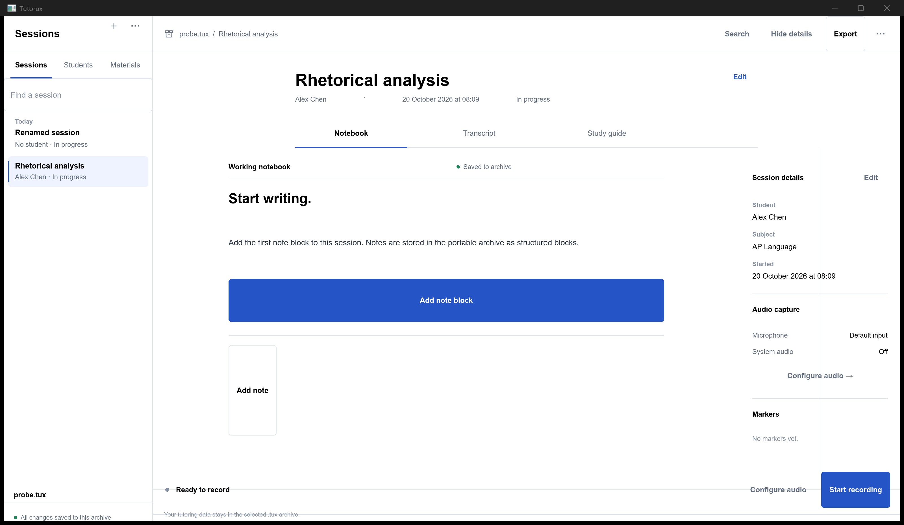
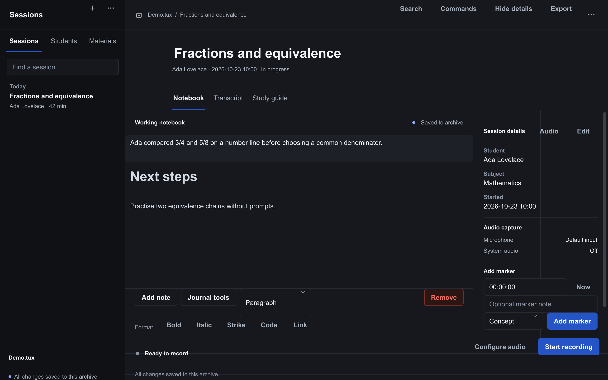
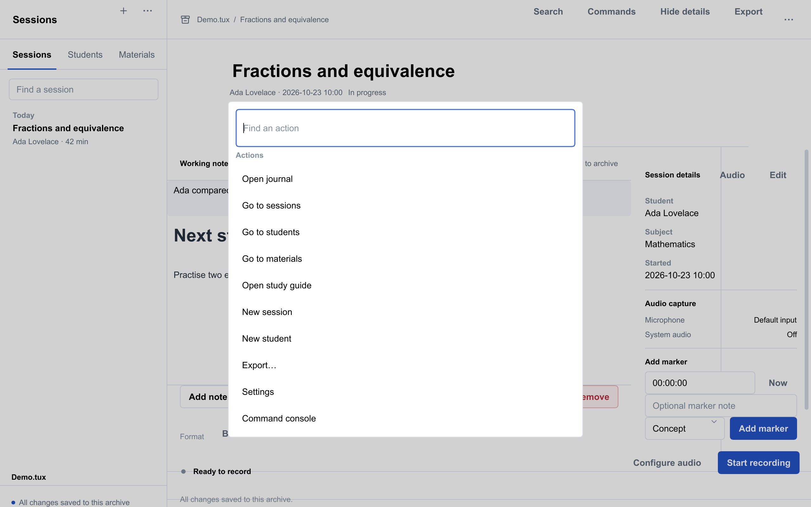
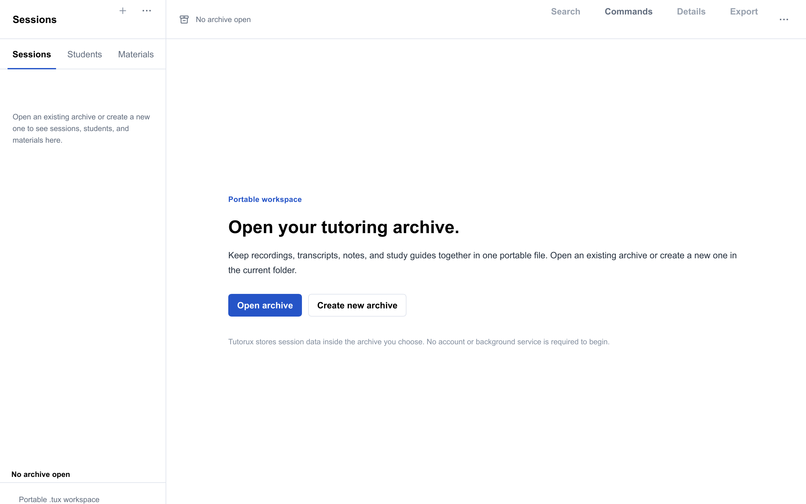

# Tutorux

Tutorux is a local-first tutoring workstation that records lessons, organizes notes and materials, builds evidence-linked study guides, and keeps every student record inside one portable `.tux` archive.

No account. No hosted service. No database to install. The archive is the application.



The same workspace in dark mode. Both themes are first-class and share one
token system.



`Ctrl+K` opens the command palette over every primary action.



## Why Tutorux

- **One file, every record.** Students, sessions, recordings, transcripts, annotations, materials, evidence, guides, settings, and credentials live in a single portable archive.
- **Built for real tutoring.** Session notes, timestamped markers, transcript corrections, learning evidence, and guide revisions are first-class records rather than files scattered across folders.
- **Evidence before prose.** Study guides cite the annotations, transcript passages, materials, and sessions that support each block.
- **Fast and native.** The desktop application uses C++23 and Slint. There is no Electron, Qt, Tauri, embedded browser, or background service.
- **Private by default.** Recording requires explicit consent. Cloud AI is opt-in, credentials are encrypted, and full archives can be sanitized before sharing.
- **Useful offline.** Notes, archives, PDF/DOCX/HTML/Markdown exports, and local guide editing work without a network connection.

## Feature tour

| Area | What is included |
| --- | --- |
| Workspace | Session navigator, notebook, transcript review, study guide editor, materials, student profiles, and a session inspector |
| Recording | Microphone, system audio, application audio, synchronized tracks, detached controls, waveform playback, WAV import/export, and interrupted-capture recovery |
| Notebook | Structured blocks, autosave, formatting, journal entries, collections, tags, search, and revision history |
| Transcript | Text/SRT/VTT import, local Whisper support, segment correction, timestamps, split/merge, speaker labels, verification, and export |
| Materials | Content-addressed images, documents, audio, and video with preview, extraction, and annotation/transcript links |
| Evidence | Source-linked extraction, review, approval, rejection, verification, and contradiction relationships |
| Study guides | Templates, section/block editing, source inspection, stale-source tracking, approval, and PDF/DOCX/HTML/Markdown/JSON export |
| Transfer | Session packages, archive copy/backup, sanitized copies, compaction, verification, and recovery |
| AI | External-agent packages, response import, OpenAI-compatible providers, native Anthropic/Gemini/Cohere/Perplexity protocols, Ollama, llama.cpp server, and optional embedded llama.cpp |

## Quick start

### Run the Windows build

The portable release is one self-contained executable. After building the portable target below, run:

```powershell
dist\Tutorux.exe
```

On first launch, choose an existing `.tux` archive or create a new one. One archive in the current folder opens directly; multiple archives show an explicit picker.



### Build from source

Requirements: CMake 3.25 or newer, a C++23 compiler, Ninja, Git, and Rust for the pinned Slint dependency. Windows builds use the UCRT64 toolchain in this repository.

```powershell
cmake --preset dev
cmake --build build/dev
ctest --preset dev
build/dev/tutorux.exe
```

Build the portable Windows executable:

```powershell
cmake --preset portable
cmake --build build/portable --target dist
dist\Tutorux.exe --version
```

The `portable` preset statically links the GUI and runtime dependencies and embeds the Noto Sans font family. It includes local Whisper support; model weights remain external and are selected explicitly.

The release profile uses the Slint software renderer with the interpreter, testing backend, live preview, and system tray disabled, then strips the executable. A full one-file Windows build measures about 56.7 MB, under the 65 MB budget. Check the measured artifact with:

```powershell
cmake --build build/portable-min --target size
```

See `docs/performance/BUDGETS.md` for the complete budget and current measurements.

### Interface

The desktop shell is a navigator, a main page, and a session inspector. The navigator and inspector collapse at the supported breakpoints, long lists are virtualized, and the notebook wraps inside its pane instead of running under the inspector. All colors come from `ui/theme.slint`; light and dark mode are first-class. The headless layout gate renders every supported window size in both themes (`docs/development/UI-TESTING.md`).

Linux and macOS use the matching static release presets. They must be built and qualified on their target operating systems:

```bash
cmake --preset portable-static-linux-release
cmake --build --preset portable-static-linux-release
ctest --preset portable-static-linux-release
```

```bash
cmake --preset portable-static-macos-release
cmake --build --preset portable-static-macos-release
ctest --preset portable-static-macos-release
```

## Everyday workflow

1. Create a student and a session.
2. Write a short plan in the notebook or attach a worksheet.
3. Record the lesson, import a recording, or work notes-only.
4. Add timestamped markers while reviewing the transcript.
5. Review extracted evidence and approve only what is supported.
6. Generate a study guide, inspect every source, edit the wording, and approve the revision.
7. Export the guide or package the session for another tutor.

The same operations are available from the command line:

```powershell
tutorux archive init Lesson.tux --name "Algebra"
tutorux --archive Lesson.tux student create --name "Maya Ortiz" --grade 10
tutorux --archive Lesson.tux session create --subject Mathematics --title "Linear equations"
tutorux --archive Lesson.tux session list
tutorux --archive Lesson.tux guide generate --session SESSION_ID
tutorux --archive Lesson.tux guide export GUIDE_ID --format pdf --output guide.pdf
```

Run `tutorux --help` for the complete command surface.

## Archive model

A `.tux` archive is a checksummed, append-only record store with:

- atomic commits and crash recovery;
- B+ tree indexes for records and references;
- content-addressed asset blobs;
- optional libsodium encryption and passphrase rotation;
- revision history for editable records;
- compaction that preserves live records.

Session packages are portable single-session transfer archives. Full archive copies and sanitized copies retain the same file format. Nothing is extracted into AppData, XDG directories, a sidecar database, or a global cache.

See [`docs/archive-format/TUX-FORMAT-V1.md`](docs/archive-format/TUX-FORMAT-V1.md) and [`docs/archive-format/SESSION-PACKAGE-V1.md`](docs/archive-format/SESSION-PACKAGE-V1.md).

## Privacy and security

- Capture starts only after explicit consent and a visible preflight check.
- Archive encryption uses Argon2id and XChaCha20-Poly1305 through libsodium.
- Provider credentials are encrypted with the archive passphrase.
- Sanitized copies exclude credentials, private annotations, selected students, selected sessions, and selected recordings unless they are explicitly included.
- External AI requests require a preview, a content hash, and explicit confirmation.
- Local endpoints are restricted to loopback; remote endpoints require HTTPS.

See [`docs/security/PORTABLE-PRIVACY.md`](docs/security/PORTABLE-PRIVACY.md).

## AI without lock-in

Tutorux does not bundle model weights and does not require an AI provider for the core workflow.

- **Manual mode:** export a source package, send it to any chat agent, then import the structured response.
- **OpenAI-compatible:** OpenAI, OpenRouter, Groq, DeepSeek, Mistral, Together, Fireworks, xAI, Cerebras, SambaNova, NVIDIA, DeepInfra, Moonshot, Novita, Nebius, SiliconFlow, MiniMax, Alibaba Cloud, Baidu, Tencent Cloud, Volcengine, Amazon Bedrock Mantle, Azure OpenAI, Cloudflare Workers AI, AI21, Z.AI, and custom endpoints.
- **Native protocols:** Anthropic Messages, Gemini GenerateContent, Cohere Chat v2, Perplexity Agent, and OpenAI Responses.
- **Local:** Ollama, LM Studio, llama.cpp server, and an optional embedded llama.cpp runtime for Full builds.

Provider capabilities and model IDs are discovered dynamically. Requests validate model compatibility before sending.

See [`docs/ai/`](docs/ai/).

## Testing

The test suite is built from real archives and loopback HTTP fixtures. It covers the archive engine, encryption, recovery, locking, imports, editing, evidence, guides, exports, provider protocols, recording IPC, and the complete CLI command surface.

```powershell
cmake --preset dev
cmake --build --preset dev
ctest --preset dev --output-on-failure
```

Current suites include:

- archive integrity, discovery, compaction, and cross-process locking;
- encryption, passphrase rotation, and encrypted credential storage;
- WAV import/export, timeline, waveform, multitrack failure, and transfer;
- transcript source parsing, evidence extraction, and evidence revision workflow;
- document piece-table editing with Unicode boundaries;
- guide generation, source validation, PDF/DOCX/HTML/Markdown export;
- local and cloud provider protocol fixtures;
- sanitized-copy selection and isolation;
- the release acceptance matrix and every command family.

For a coverage build, configure a separate tree with GCC coverage flags and run the same tests:

```powershell
cmake -S . -B build/cov -G Ninja -DCMAKE_BUILD_TYPE=Debug `
  -DBUILD_TESTING=ON -DTUTORUX_BUILD_GUI=OFF -DTUTORUX_FETCH_PODOFO=ON `
  -DCMAKE_C_FLAGS="--coverage -O0 -g" `
  -DCMAKE_CXX_FLAGS="--coverage -O0 -g" `
  -DCMAKE_EXE_LINKER_FLAGS="--coverage"
cmake --build build/cov
ctest --test-dir build/cov --output-on-failure
```

## Project layout

```text
src/archive/        portable archive engine, encryption, recovery, sanitization
src/command/        CLI dispatcher, JSON, ZIP, session packages
src/domain/         students, sessions, annotations, journal, guides
src/document/       piece-table editor, DOCX and PDF renderers
src/audio/          capture, playback, timeline, waveform, WAV
src/transcription/  text/SRT/VTT import and optional Whisper
src/intelligence/   evidence graph, context packing, scheduling, waveforms
src/ai/             provider transports and protocol adapters
src/gui/            Slint desktop controller
ui/                 Slint interface, theme, panes, overlays
web/                static browser client sources
tests/              integration, protocol, and unit suites
docs/               format, security, AI, audio, and operations documentation
```

## Documentation

- [Archive format](docs/archive-format/TUX-FORMAT-V1.md)
- [Session packages](docs/archive-format/SESSION-PACKAGE-V1.md)
- [Portable privacy](docs/security/PORTABLE-PRIVACY.md)
- [Recording and playback](docs/audio/)
- [Study guide editor](docs/guides/EDITOR-ENGINE.md)
- [AI providers](docs/ai/)
- [Diagnostics and benchmarks](docs/diagnostics/DIAGNOSTICS-AND-BENCHMARKS.md)
- [Dependency pins](docs/dependencies/DEPENDENCY-PINS.md)
- [Static release builds](docs/dependencies/PORTABLE-STATIC-BUILDS.md)

## Status

Tutorux 1.0 targets the Windows UCRT64 desktop build. Linux and macOS have source-level platform implementations and matching presets; they require qualification on those operating systems. The static WebAssembly client is maintained in the same repository and is built separately from the desktop application.

## License

Tutorux is licensed under GPL-3.0-only. See [`LICENSE`](LICENSE). The Slint runtime and the embedded Noto Sans fonts are distributed under their respective licenses; release packages include the applicable notices.
