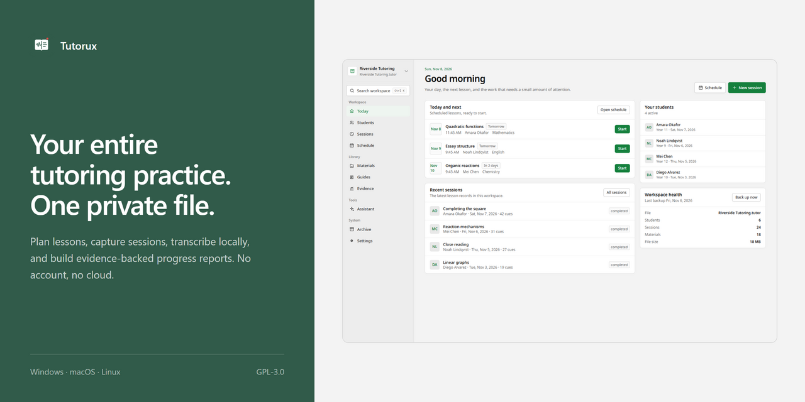
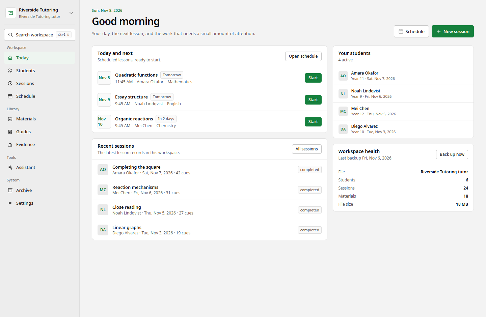
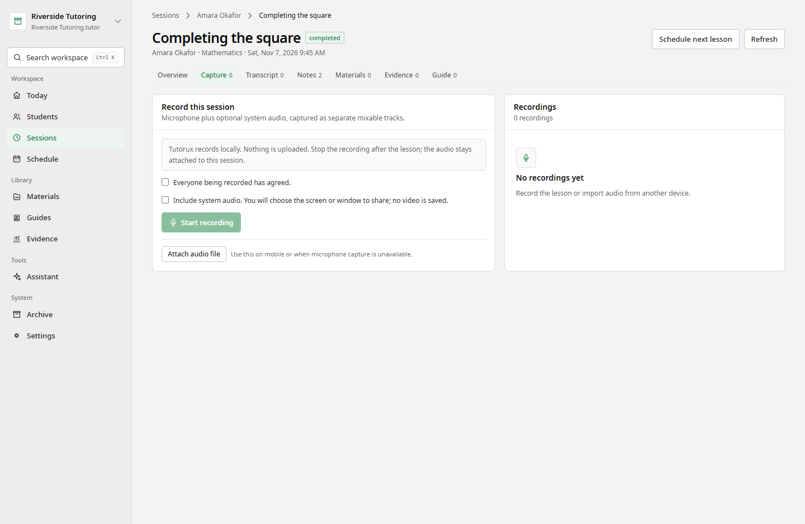
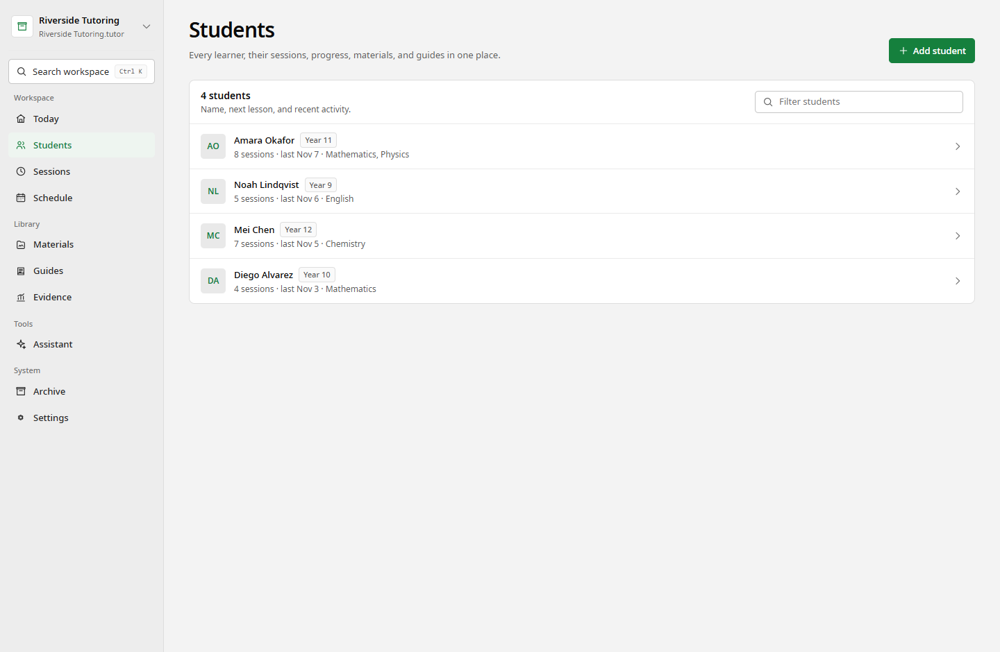
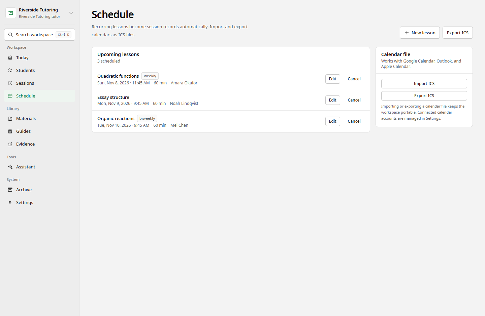
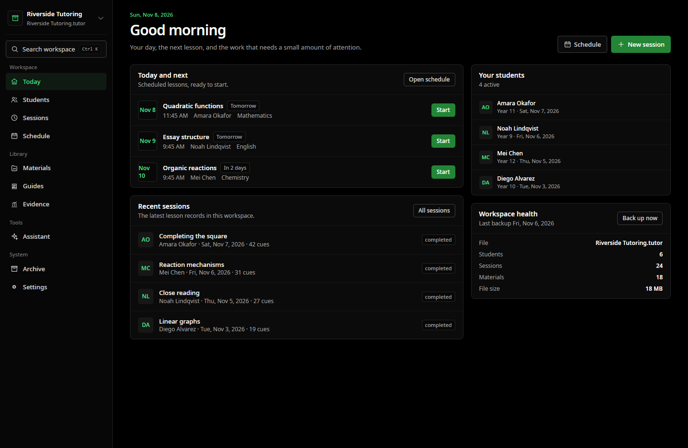
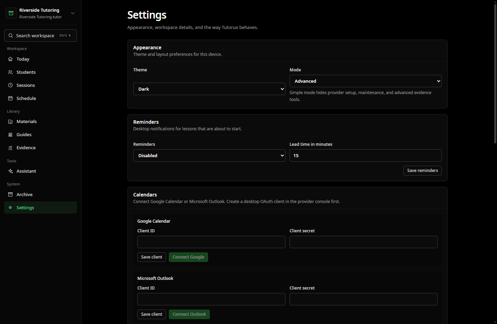
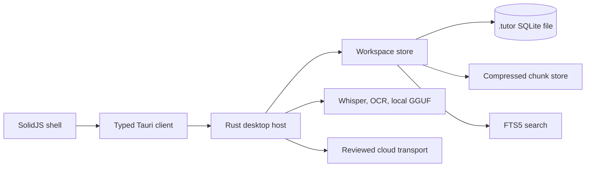

<div align="center">



# Tutorux

**Your entire tutoring practice. One private file.**

Plan lessons, capture sessions, transcribe locally, and build evidence-backed progress reports without an account or a cloud.

[](LICENSE) [](#quick-start) [](https://tauri.app) [](https://www.rust-lang.org) [](https://www.solidjs.com) [](CONTRIBUTING.md)

[Download](#quick-start) · [Features](#feature-tour) · [Screenshots](#screenshots) · [Architecture](#architecture) · [Contributing](CONTRIBUTING.md)

</div>

---

## Why Tutorux

Tutoring software usually forces a choice: a cloud platform that owns your lesson data, or a folder of documents that slowly turns into chaos.

Tutorux is a different shape. A **single portable `.tutor` file** holds the whole practice — students, sessions, recordings, transcripts, notes, materials, evidence, goals, and guides. It stays on your device. There is no account, no sync service, and no workspace database in someone else's cloud.

It is built for the tutor who wants:

- **One source of truth** instead of notes in five apps.
- **A private workspace** instead of a vendor-controlled account.
- **Session evidence** instead of memory and guesswork.
- **Local AI** for transcription, OCR, and study material generation.
- **A real desktop app** built with Rust, SQLite, Tauri, and SolidJS.

> If Tutorux saves you time, a star helps another tutor find it.

## Screenshots

| Today | Session capture |
| --- | --- |
|  |  |
| **Students** | **Schedule** |
|  |  |
| **Dark theme** | **Settings** |
|  |  |

## Feature tour

| Area | What it does |
| --- | --- |
| **Today** | A daily agenda, next lesson, recent sessions, student list, and workspace backup health. |
| **Students** | Profiles, subjects, goals, skill ratings, session history, evidence, materials, and printable progress reports. |
| **Sessions** | Overview, capture, transcript, notes, materials, evidence, and guide tabs in one lesson record. |
| **Capture** | Microphone plus optional system audio, separate tracks, local mixer, audio-file import, and local Whisper transcription. |
| **Schedule** | One-off and recurring lessons, interval and end dates, next-lesson planning, conflict warnings, reminders, and ICS import/export. |
| **Materials** | Files, links, previews, image OCR, scanned-PDF OCR, and searchable extracted text. |
| **Guides** | Markdown guides, templates, print/PDF, and session-to-guide generation. |
| **Evidence** | Observations, approval status, linked evidence graph, timelines, and student progress context. |
| **Search** | Global FTS5 search across students, sessions, notes, transcripts, materials, guides, and evidence with `Ctrl/Cmd+K`. |
| **Assistant** | Reviewed cloud AI requests plus local GGUF inference; nothing leaves the machine without an explicit action. |
| **Archive** | Verified backups, backup-age health, compaction, search reindex, recovery copies, sanitized copies, and best-effort SQLite salvage. |
| **Privacy** | Optional SQLCipher encryption, OS credential-store keys, portable encrypted backups, and 90-day Trash recovery. |

## The one-file workspace

A `.tutor` workspace is a SQLite database with:

- Typed tables for students, sessions, schedule events, journals, observations, transcript cues, materials, recordings, guides, evidence, goals, skills, settings, and AI jobs.
- FTS5 full-text search.
- Content-addressed, zstd-compressed BLOB chunks with deduplication.
- Optional SQLCipher encryption at rest.
- 90-day Trash recovery.
- Manual verified backups with backup-age health.
- Portable `.tutorpkg` session packages.

That means you can move, copy, back up, encrypt, or archive a whole tutoring practice as one file.

See [the workspace format](docs/archive-format/TUTOR-FORMAT.md) for the full schema.

## Privacy by default

- No account, sync service, telemetry, or hosted workspace.
- Recordings, transcripts, notes, and materials stay local.
- Cloud AI is opt-in, reviewed, and sent through native host allowlists.
- Calendar and AI credentials live in the OS credential store, not the workspace.
- Encrypted workspaces use SQLCipher; the key is zeroized on close.
- Sanitized copies remove private content before sharing.

## Quick start

### Download

Grab the latest build from [Releases](https://github.com/richie-rich90454/tutorux/releases/latest).

| Artifact                         | Use                                                         |
| -------------------------------- | ----------------------------------------------------------- |
| `Tutorux_1.0.0_x64_en-US.msi`    | Windows installer                                           |
| `Tutorux_1.0.0_x64-setup.exe`    | Windows NSIS installer                                      |
| `Tutorux_1.0.0_x64_portable.exe` | Single-file portable Windows build; no separate runtime DLL |

### Build from source

Requirements: Node.js 22.13+, pnpm 12.14, Rust 1.90+, the native Tauri prerequisites, and WebView2 on Windows.

```sh
pnpm install --frozen-lockfile
pnpm run pdfium:fetch
pnpm run desktop:dev
```

`pnpm run desktop:build` fetches the PDFium runtime when needed and produces the MSI, NSIS setup, and portable EXE under `release/`. The portable EXE embeds the runtime. On macOS/Linux, run `pnpm run pdfium:fetch` before any Rust build command so the embedded runtime is available at compile time.

For the full verification loop:

```sh
pnpm run typecheck
pnpm run lint
pnpm run format:check
pnpm run test:coverage
pnpm run build
cargo fmt --manifest-path src-tauri/Cargo.toml --all -- --check
cargo clippy --manifest-path src-tauri/Cargo.toml --all-targets --all-features -- -D warnings
cargo test --manifest-path src-tauri/Cargo.toml --lib
pnpm run desktop:build
```

## Architecture



- **Frontend:** SolidJS, TypeScript, Vite, Tailwind CSS.
- **Desktop shell:** Tauri 2.
- **Core:** Rust, SQLite/SQLCipher, FTS5, zstd, SQLite online backup.
- **Local AI:** Whisper transcription, image/PDF OCR, GGUF inference.
- **Storage:** one `.tutor` file per workspace.

More detail: [Architecture](docs/ARCHITECTURE.md), [TypeScript development](docs/development/TYPESCRIPT.md), [Verification](docs/verification.md), [Production readiness](docs/engineering/PRODUCTION-READINESS.md).

## Status and deliberate limits

Tutorux is a working desktop core for a single-tutor local workflow. It is intentionally local-first and honest about qualification boundaries.

- Live Google/Microsoft OAuth, Apple CalDAV, cloud AI, and local GGUF generation require external credentials, models, or accounts. Their code paths and runbooks are documented as environment-gated.
- Scanned PDF OCR is supported. Other document formats must be converted first.
- Reminders run while Tutorux is open; there is no background scheduler when the app is closed.
- Salvage recovers readable SQLite rows; physically destroyed pages cannot be reconstructed.
- The 1 GiB qualification passes. The 100 GB qualification and full capture-device matrix are environment-gated.

See [HANDOFF.md](HANDOFF.md) for the complete status and qualification matrix.

## Contributing

Contributions are welcome: bug reports, feature proposals, documentation, tests, and platform qualification.

1. Read [CONTRIBUTING.md](CONTRIBUTING.md) and [CODE_OF_CONDUCT.md](CODE_OF_CONDUCT.md).
2. Open an issue using the templates in `.github/ISSUE_TEMPLATE/`.
3. Keep changes focused and include tests where the behavior can regress.
4. Run the verification commands above before opening a pull request.

Please do not report security issues in public. See [SECURITY.md](SECURITY.md).

## Credits and third-party licenses

- **PDFium** — local PDF rendering for scanned-PDF OCR. Distributed by [pdfium-binaries](https://github.com/bblanchon/pdfium-binaries), licensed under BSD-3-Clause. The runtime is embedded in the portable executable. Attribution: [src-tauri/resources/pdfium/LICENSE](src-tauri/resources/pdfium/LICENSE).
- **Ocrs** — local OCR engine and bundled models. Models are trained on the HierText dataset by Google Research and licensed under CC BY-SA 4.0. Attribution: [src-tauri/resources/ocr/LICENSE.md](src-tauri/resources/ocr/LICENSE.md).
- **Whisper / whisper.cpp** — local speech transcription, MIT. Tutorux uses `whisper-rs` and a bundled multilingual Whisper model.
- **llama.cpp** — local GGUF inference, MIT. Tutorux uses `llama-cpp-2`.
- **SQLite and SQLCipher** — public domain and BSD-style licenses.
- **Tauri** — MIT or Apache-2.0.
- **SolidJS** — MIT.
- **Tailwind CSS** — MIT.
- **Noto Sans** — SIL Open Font License 1.1. See [frontend/assets/fonts/OFL.txt](frontend/assets/fonts/OFL.txt).
- Remaining dependency licenses are recorded in `Cargo.lock` and `pnpm-lock.yaml`.

## License

Tutorux is licensed under **GPL-3.0-only**. See [LICENSE](LICENSE).

---

<div align="center">

**One file. Your practice. Your data.**

[Back to top](#tutorux)

</div>
