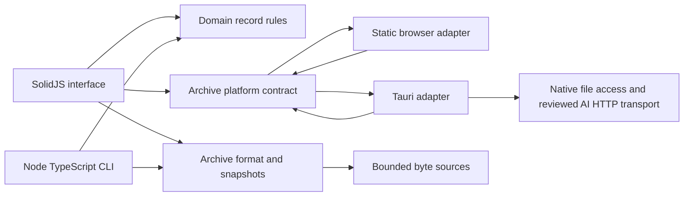

# Tutorux architecture

This document describes the active TypeScript and Tauri implementation. The legacy C++/Slint architecture is retained in the repository as a migration reference and is not an input to the web or Tauri builds.

## Modules

- `frontend/archive/format.ts` owns v1 header, record-frame, payload, and checksum encoding and decoding. Integer fields whose on-disk widths exceed JavaScript's safe integer range use `bigint`.
- `frontend/archive/archive.ts` opens archive snapshots, validates commit/index structure, resolves records, creates archives, appends immutable generations, and verifies every current primary record (including trashed and forward-compatible types). It can read audio chunk metadata from the session/track index without loading PCM blobs. Its secondary guide-source index retains historical aliases and appends a stale guide revision when a cited source, including a journal-notes document, changes.
- `frontend/archive/source.ts` defines bounded byte reads and browser/memory/composite sources. `node-source.ts` adds positional reads for the CLI.
- `frontend/domain/records.ts` creates and updates the supported student, session, and journal record forms, including legacy-compatible collection/tag links and reversible organizer archiving. It preserves unknown fields, protects structured note documents, and validates UTF-8 byte limits. `domain/annotations.ts` validates timestamped session observations and provides immutable update, duplicate, and soft-remove operations. `domain/transcript.ts` parses text/SRT/VTT, writes legacy-compatible cue records, sorts and exports cues, applies review edits, splits and merges cues, and validates session-scoped material links. The archive revision chain supplies transcript history and restore to the SolidJS UI and TypeScript CLI. `domain/audio.ts` validates indexed PCM track timelines, checks selected chunk payloads, fills missing frames with silence, and creates bounded WAV excerpts for transcript playback, as well as streaming full-track WAV exports while preserving sample format and filling declared gaps with silence. `domain/wav.ts` imports bounded RIFF/WAVE PCM audio as legacy-compatible, checksummed archive chunks and track metadata. `domain/assets.ts` writes legacy-compatible 8 MiB content-addressed asset chunks and verifies hash, size, and chunk order before preview or export. `domain/evidence.ts` extracts annotation-backed evidence and transcript candidates, validates source revisions before approval, and adds session-scoped graph edges. `domain/guides.ts` reads and writes the legacy guide section/block schema, validates session-scoped source citations, and renders Markdown exports.
- `frontend/platform/types.ts` defines the browser/desktop file contract. `browser.ts` handles browser picker and download behavior; `tauri.ts` uses native dialogs, bounded native file reads, launch-file handoff, native menu events, and native transcript export.
- `frontend/main.tsx` assembles the workspace and owns archive state, while `frontend/GuidesPage.tsx` provides the templated guide editor, review actions, and Markdown/HTML exports. Components call the shared archive and domain modules; they do not duplicate archive serialization rules.
- `cli/main.ts` parses CLI arguments and coordinates the same domain/archive functions with Node file I/O, including guide and custom-template operations.
- `src-tauri/src/main.rs` is a thin Rust host. It authorizes selected archives, services bounded range reads, stages archive saves, writes transcript exports atomically after native path selection, routes initial and subsequent `.tux` launches into the focused application window, and defines native File/Edit/View menus. `ai_transport.rs` performs one endpoint- and hash-validated provider request after explicit user review, enforces provider-route and body limits, and streams response bytes to TypeScript. It does not parse provider protocols or implement Tutorux business rules or archive parsing.

## Dependency direction

The domain layer depends only on ordinary TypeScript. Archive format code depends on byte sources and format utilities, not on SolidJS, Tauri, or Node-specific UI state. Platform adapters implement file operations and the separately reviewed AI transport boundary. The UI and CLI coordinate those shared modules at their respective boundaries.

Vite selects `browser.ts` for the static build and `tauri.ts` for the desktop build through the `@platform` alias. The web bundle therefore does not transitively include Tauri APIs. The native host is accessed only from the desktop adapter.

## State and persistence

The current browser workspace is an in-memory snapshot. Record writes create a new append-only generation; users explicitly save that generation to the selected file. The desktop adapter streams archive reads and writes in bounded chunks. The browser File System Access API writes directly when available; the fallback produces a download and holds the edited archive in memory.

No database or hosted service is part of the current migration slice. Preferences persist the system/light/dark appearance choice in browser local storage; system mode follows operating-system appearance changes. The existing archive remains the canonical user-data format.

Session and journal notes remain in legacy-compatible `journal-notes` records. The Solid editor reads and writes ordered, typed blocks in that schema, keeps their IDs stable through edits, and leaves unknown block kinds or extension fields untouched.

## Error handling and security boundaries

Archive reads validate source ranges before touching a file. The archive parser checks header/record CRCs, bounded payload sizes, index depth, frame boundaries, commit roots, and record identity. Archive health and `archive verify` decode every current primary record, including trashed and unknown-type records, and check its index reference. Domain form input has size and control-character limits. Tauri file reads require an opaque token issued after a file picker selection and cap each native range request at 4 MiB; the TypeScript adapter composes larger archive frames from bounded reads. Saves use a same-directory temporary file and restore the old destination if publication fails. Asset imports are currently capped at 256 MiB to bound the browser-side transaction; importing larger material files requires a streaming writer.

Encrypted archives can be unlocked in the TypeScript implementation, and the UI and CLI can create, edit, verify, and rotate encrypted archives. The CLI can also create an encrypted sanitized copy from an unlocked encrypted source, with an optional credential-record selection; callers provide a fresh destination passphrase through an environment variable. Sanitized output is staged, fully verified, and atomically published. Recovery, repair, and compaction of encrypted archives remain unavailable. See the [feature inventory](migration/feature-inventory.md) for remaining security and migration work.

## Performance-sensitive paths

- Archive reads are positional and bounded; opening a large archive does not first copy the whole file into JavaScript memory.
- Archive writes reuse the original bytes and append a new index/commit generation.
- The primary record index is loaded into a map for predictable lookups; building a generation sorts its current entries once.
- Browser fallback export is capped at 512 MiB because it creates a Blob. Desktop and Node paths stream output in 1 MiB chunks.

The [TypeScript benchmark report](performance/TYPESCRIPT-BASELINE.md) records the current measured baseline and its limits.

## Verification strategy

Vitest covers archive framing, snapshots, and CLI workflows. Playwright covers browser create/edit/save/reopen flows and responsive behavior. CI runs these checks and builds both the static app and the Tauri package on Windows, macOS, and Linux. A Windows interoperability check confirms that the TypeScript reader opens an archive emitted by the existing C++ executable. Full differential coverage is still pending for domains that have not yet been ported.

## Why this stack

The application uses standard TypeScript, SolidJS, Vite, and Tauri APIs with explicit module boundaries. This keeps business rules in inspectable TypeScript, lets the same UI run as a static browser app and a desktop app, and leaves Rust focused on native file operations. The goal is smaller, local changes with ordinary tooling; the migration inventory tracks where that goal is not yet met because old behavior remains unported.
