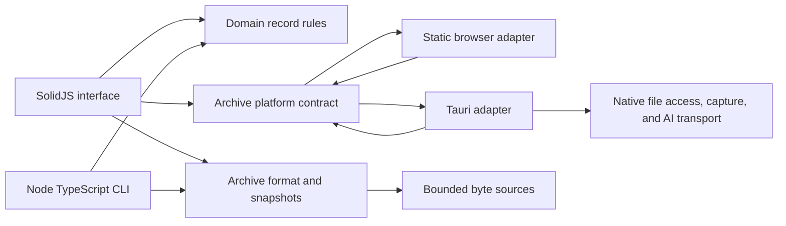

# Tutorux architecture

Tutorux is a local-first tutoring workspace implemented in TypeScript, SolidJS, Vite, Tauri 2, and Rust. The browser and desktop applications share the same archive engine, domain rules, and UI.

## Modules

- `frontend/archive/format.ts` owns v1 header, record-frame, payload, checksum, and BLOB encoding. Integer fields whose on-disk widths exceed JavaScript's safe integer range use `bigint`.
- `frontend/archive/archive.ts` opens snapshots, validates commit/index structure, resolves records, creates archives, appends immutable generations, and verifies every current primary record plus secondary indexes, asset manifests, guide sources, credential placement, and physical frame spans. It reads audio-chunk metadata through the session/track index without loading PCM blobs.
- `frontend/archive/source.ts` defines bounded byte reads and browser/memory/composite sources. `node-source.ts` adds positional reads for the CLI.
- `frontend/domain/records.ts` creates and updates students, sessions, and journal records while preserving unknown fields and validating UTF-8 bounds. `domain/annotations.ts` validates timestamped observations. `domain/transcript.ts` parses text/SRT/VTT, writes cue records, and supports review, split/merge, history, and export.
- `frontend/domain/audio.ts` validates indexed PCM timelines, fills gaps with silence, builds bounded playback previews, and streams full-track WAV/RF64 exports. `domain/wav.ts` imports RIFF/WAVE audio in bounded chunks with durable recovery state. `domain/audio-mix.ts` mixes 2–8 tracks incrementally.
- `frontend/domain/assets.ts` writes 8 MiB content-addressed asset chunks and verifies hash, size, and order before preview or export. `domain/evidence.ts` extracts and validates source-backed evidence and graph edges. `domain/guides.ts` reads and writes the guide section/block schema, applies template overrides, validates citations, and renders Markdown/HTML/Word/PDF exports.
- `frontend/platform/types.ts` defines the browser/desktop file contract. `browser.ts` handles pickers and downloads; `tauri.ts` uses native dialogs, bounded reads, launch-file handoff, menu events, and native exports.
- `frontend/platform/synchronized-audio.ts` adapts native synchronized capture events, preserving rate, channel count, sample format, gaps, and device-discontinuity markers before archive commits.
- `frontend/main.tsx` assembles the workspace and owns archive state. Page components under `frontend/` provide the journal, sessions, observations, transcripts, materials, evidence, guides, AI, and settings surfaces.
- `cli/main.ts` is the entry point; command implementations live in `cli/commands/`. The CLI coordinates the same domain and archive functions with Node file I/O.
- `src-tauri/src/main.rs` is the Rust host: authorized archive range reads, staged saves, single-instance `.tux` launch routing, native menus, credential storage, synchronized audio capture, Whisper, and streamed AI HTTP transport. Platform modules under `src-tauri/src/platform/` implement microphone, system, and application capture. The `tutorux-audio-helper` binary in the same crate provides CLI capture and device probing.

## Dependency direction

The domain layer depends only on ordinary TypeScript. Archive format code depends on byte sources and format utilities, not SolidJS, Tauri, or Node UI state. Platform adapters implement file operations and the reviewed AI transport boundary. The UI and CLI coordinate those shared modules at their boundaries.

Vite selects `browser.ts` for the static build and `tauri.ts` for the desktop build through the `@platform` alias. The web bundle does not include Tauri APIs. The native host is accessed only from the desktop adapter.

## State and persistence

The browser workspace is an in-memory snapshot. Record writes create a new append-only generation; users explicitly save that generation to the selected file. The desktop adapter streams archive reads and writes in bounded chunks. The File System Access API writes directly when available; the fallback produces a download.

Preferences persist the system/light/dark appearance choice in the active archive's `ui.theme` setting. Browser local storage is only a fallback when the selected archive has no valid theme setting. Encryption keys, credentials, and record contents never leave the archive or the operating-system credential store.

Session and journal notes remain in legacy-compatible `journal-notes` records. The editor reads and writes ordered, typed blocks, keeps their IDs stable, preserves unknown block kinds, and stores removed blocks for Trash recovery.

## Error handling and security boundaries

Archive reads validate source ranges before touching a file. The parser checks header/record CRCs, bounded payload sizes, index depth, frame boundaries, commit roots, and record identity. `archive verify --full` decodes current records, verifies secondary indexes and asset manifests, checks citations and credential placement, and rejects overlapping frames. Domain input has size and control-character limits. Tauri file reads require an opaque token issued after a picker selection and cap each range request at 4 MiB; the TypeScript adapter composes larger frames from bounded reads. Saves use a same-directory temporary file and restore the old destination if publication fails.

Encrypted archives support creation, unlock, edits, rotation, verification, recovery, repair, compaction, sanitization, and backups. Credential records are accepted only in encrypted archives. Sanitized output is staged, fully verified, and atomically published. See [the feature inventory](migration/feature-inventory.md) for the completed parity record and remaining platform qualification.

## Performance-sensitive paths

- Archive reads are positional and bounded; opening a large archive does not copy the whole file into JavaScript memory.
- Archive writes reuse original bytes and append a new index/commit generation.
- The primary record index is loaded into a map for predictable lookups; building a generation sorts current entries once.
- Audio import, mix, waveform, and export paths stream in bounded chunks.
- Browser fallback export is capped at 512 MiB because it creates a Blob. Desktop and Node paths stream output in 1 MiB chunks.

The [TypeScript benchmark report](performance/TYPESCRIPT-BASELINE.md) records the measured baseline.

## Verification strategy

Vitest covers archive framing, snapshots, verification, maintenance, domain rules, audio transforms, AI packaging, and CLI workflows from `tests/cli/` and `tests/frontend/`. Playwright covers browser create/edit/save/reopen, audio, AI, encrypted-archive, session-package, and workspace flows in `tests/e2e/`. CI runs type checking, linting, formatting, unit tests, browser tests, the static build, and the Tauri package on Windows, macOS, and Linux.

## Why this stack

The application uses standard TypeScript, SolidJS, Vite, and Tauri APIs with explicit module boundaries. Business rules stay in inspectable TypeScript, the same UI runs as a static browser app and a desktop app, and Rust handles native file, audio, and network access. The goal is small local changes with ordinary tooling.
