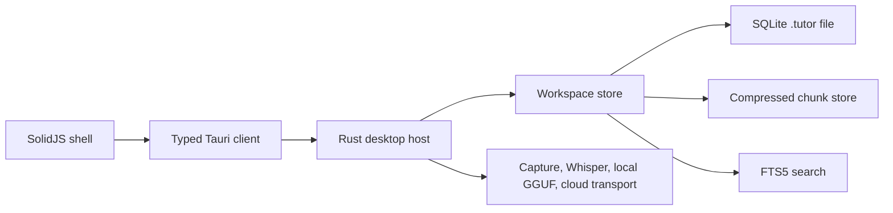

# Tutorux architecture

Tutorux is a local-first desktop tutoring workspace implemented in SolidJS, TypeScript, Vite, Tauri 2, Rust, and SQLite. One `.tutor` file is the workspace.

## Layers

### `frontend/app`

The application shell. It owns:

- the sidebar and mobile drawer;
- hash routing and route focus;
- the workspace provider and archive lifecycle;
- the command palette;
- the native-menu event listener;
- the welcome screen and saved-workspace reopening, including ignoring remembered temporary workspaces from smoke runs;

No page reads an archive file directly.

### `frontend/design-system`

The shared UI vocabulary:

- tokens and surface hierarchy;
- buttons, fields, inputs, tabs, panels, badges, notices, empty states;
- page headers and confirmation controls.

The visual system is deliberately flat: no gradients, backdrop blur, glass panels, accent bars, or all-caps labels.

### `frontend/features`

Feature-owned screens and workflows:

- `today` — daily overview and continuation state;
- `students` — list, profile, goals, skills, evidence, materials, guides, reports;
- `sessions` — list, session detail, capture, transcript, notes, materials, evidence, guide;
- `schedule` — schedule series, generated sessions, ICS import/export;
- `materials` — files, links, previews;
- `guides` — list, editor, templates, export;
- `evidence` — evidence records and approval;
- `assistant` — cloud/local AI tasks and provider setup;
- `archive` — health, backup, Trash;
- `settings` — appearance, workspace details, shortcuts, encryption, mode.

Features use `frontend/api/client.ts`, not Tauri internals.

### `frontend/api`

The typed boundary:

- `client.ts` wraps every workspace command;
- `types.ts` mirrors the Rust DTOs;
- `ai.ts` builds reviewed cloud requests and handles local GGUF;
- `embedded-ai.ts` owns local GGUF model inspection/loading and token streaming;
- `whisper.ts` decodes recorded audio, resamples to 16 kHz mono WAV, and calls the bundled Whisper runtime;
- `calendar` commands in `client.ts` configure OAuth/CalDAV accounts and sync events.

### `src-tauri/src/store`

The persistent workspace:

- `schema.rs` — SQLite schema, FTS5, indexes;
- `repo.rs` — students, sessions, workspace summary, recurring-session queries;
- `content.rs` — journal, observations, transcript cues, guides, evidence, goals, skills;
- `schedule.rs` — recurring lesson materialization;
- `materials.rs` — file import, link records, chunked reads, text indexing;
- `recordings.rs` — recording metadata and compressed audio chunks, including separate microphone/system tracks;
- `search.rs` — FTS5 query handling;
- `backup.rs` — SQLite online backup with encryption preservation and integrity check;
- `maintenance.rs` — compaction, reindexing, recovery copies, and sanitized copies;
- `packages.rs` — portable `.tutorpkg` session export/import;
- `reminders.rs` — due-lesson reminders for desktop notifications;
- `trash.rs` — 90-day Trash listing, restore, permanent deletion;
- `salvage.rs` — best-effort row recovery into a new workspace;
- `settings.rs` — key/value settings and workspace rename;
- `mod.rs` — the Tauri command surface.

### `src-tauri/src/calendar.rs`

- Google and Microsoft OAuth 2.0 with PKCE and a loopback callback.
- Apple Calendar/CalDAV with an app-specific password.
- OS credential-store token storage and calendar event upserts.

### `src-tauri/src/ocr.rs`

Bundled Ocrs models for local image OCR. Models are embedded; OCR never sends an image to a service.

### `src-tauri/src/host.rs`

The Tauri composition root. It manages the workspace state, native menu, file launch handoff, dialog and notification plugins, credential commands, AI transport, Whisper, local GGUF, OCR, calendar, and native capture commands.

## Data flow

1. A page calls a typed function in `frontend/api/client.ts`.
2. Tauri invokes the matching Rust command.
3. The command locks the single `WorkspaceDb`.
4. The store validates input and executes a SQL statement or transaction.
5. FTS rows are updated in the same operation.
6. The command returns a typed DTO.
7. Solid signals/resources update the affected view.

Writes are committed to SQLite immediately. There is no separate “save the whole archive” step. Manual backups are explicit.

## Persistence and consistency

- `PRAGMA journal_mode = WAL` allows incremental writes.
- `PRAGMA synchronous = FULL` favors durability.
- One writer connection is serialized behind a mutex.
- Keyset-friendly indexes cover session time, student time, observations, cues, and trash state.
- Soft deletion uses `deleted_at`; the UI keeps 90 days of recoverable items.
- Backups use the SQLite online backup API and run an integrity check before returning success.
- Encrypted workspaces use SQLCipher. The in-memory key is zeroized on close. Backups apply the same key to the destination.

## Search

A single FTS5 table indexes students, sessions, journal entries, observations, transcript cues, materials, guides, and evidence. Each entity rewrite replaces its indexed row. Queries are tokenized and quoted before `MATCH`, then ranked with FTS5 `rank`.

## Media

- Fixed 4 MiB chunks.
- zstd compression when it reduces size; raw storage otherwise.
- SHA-256 content hashes deduplicate identical chunks.
- Recorded audio is stored as compressed chunks with recording metadata.
- Capture writes a mixed track plus separate microphone/system tracks when available; the UI mixes them with per-track gain and mute.
- Material previews are capped in memory; large media is stored without a full-file load.
- Waveforms and thumbnails are generated in the UI only when needed.

## Packages and copies

- A `.tutorpkg` session package is a small SQLite database containing one session, its student context, notes, evidence, guides, materials, recordings, blobs, and search rows.
- Import remaps every entity ID and rewrites evidence source IDs to the imported records.
- A sanitized `.tutor` copy removes recordings, transcripts, journals, observations, materials, AI jobs, and calendar accounts; it masks student and session names and clears notes.
- A recovery copy is a verified SQLite snapshot of a healthy workspace.

## Calendar integration

- Google and Microsoft use OAuth with PKCE and a loopback redirect. Client IDs and optional secrets are configured in Settings; secrets and tokens stay in the OS credential store.
- Apple Calendar uses CalDAV with an app-specific password.
- Imported events upsert by provider account and external ID. Google and Microsoft responses are paged.
- Calendar OAuth app registration is external to Tutorux.

## OCR

- OCR runs locally with embedded Ocrs models.
- Supported image formats are PNG, JPEG, WebP, BMP, TIFF, and GIF.
- PDF pages are rendered locally with bundled PDFium. Embedded text is used when a page already has enough text; low-text pages are rasterized and OCRed.
- Extracted text is stored on the material and indexed for search.
- The PDFium runtime is fetched by `pnpm run pdfium:fetch` and bundled by the release build.

## Reminders

- A 30-second watcher asks the store for lessons inside the configured lead window.
- Notifications use the native notification plugin; the lead time and enable switch live in Settings.
- Due schedule events and standalone planned sessions are both covered.

## Security boundaries

- Archive and material paths come from native dialogs, not arbitrary user strings.
- AI credentials are stored in the OS credential store.
- Cloud AI requests require a review checkbox; local GGUF requests never leave the device.
- SQLCipher protects an encrypted workspace at rest.
- The old browser adapter, `.tux` parser, CLI, console, and associated native file-authorization surface were removed.

## Performance direction

The store is designed for large workspaces:

- no full archive reload after each edit;
- normalized row queries instead of field-map scans;
- FTS5 instead of linear text scans;
- bounded BLOB reads;
- keyset-friendly indexes;
- UI resources scoped to the active route.

A 100 GB qualification run remains future work. See [Performance design](performance/TYPESCRIPT-BASELINE.md).
