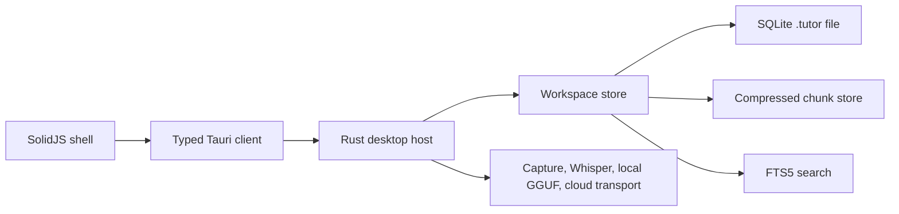

# Tutorux architecture

Tutorux is a local-first desktop tutoring workspace implemented in SolidJS, TypeScript, Vite, Tauri 2, Rust, and SQLite. One `.tutor` file is the workspace.

## Layers

### `frontend/app`

The application shell. It owns:

- the sidebar and mobile drawer;
- hash routing and route focus;
- the workspace provider and archive lifecycle;
- the command palette;
- the native-menu event listener;
- the welcome screen and saved-workspace reopening.

No page reads an archive file directly.

### `frontend/design-system`

The shared UI vocabulary:

- tokens and surface hierarchy;
- buttons, fields, inputs, tabs, panels, badges, notices, empty states;
- page headers and confirmation controls.

The visual system is deliberately flat: no gradients, backdrop blur, glass panels, accent bars, or all-caps labels.

### `frontend/features`

Feature-owned screens and workflows:

- `today` — daily overview and continuation state;
- `students` — list, profile, goals, skills, evidence, materials, guides, reports;
- `sessions` — list, session detail, capture, transcript, notes, materials, evidence, guide;
- `schedule` — schedule series, generated sessions, ICS import/export;
- `materials` — files, links, previews;
- `guides` — list, editor, templates, export;
- `evidence` — evidence records and approval;
- `assistant` — cloud/local AI tasks and provider setup;
- `archive` — health, backup, Trash;
- `settings` — appearance, workspace details, shortcuts, encryption, mode.

Features use `frontend/api/client.ts`, not Tauri internals.

### `frontend/api`

The typed boundary:

- `client.ts` wraps every workspace command;
- `types.ts` mirrors the Rust DTOs;
- `ai.ts` builds reviewed cloud requests and handles local GGUF;
- `embedded-ai.ts` owns local GGUF model inspection/loading and token streaming;
- `whisper.ts` decodes recorded audio, resamples to 16 kHz mono WAV, and calls the bundled Whisper runtime.

### `src-tauri/src/store`

The persistent workspace:

- `schema.rs` — SQLite schema, FTS5, indexes;
- `repo.rs` — students, sessions, workspace summary, recurring-session queries;
- `content.rs` — journal, observations, transcript cues, guides, evidence, goals, skills;
- `schedule.rs` — recurring lesson materialization;
- `materials.rs` — file import, link records, chunked reads, text indexing;
- `recordings.rs` — recording metadata and compressed audio chunks;
- `search.rs` — FTS5 query handling;
- `backup.rs` — SQLite online backup with encryption preservation and integrity check;
- `trash.rs` — 90-day Trash listing, restore, permanent deletion;
- `settings.rs` — key/value settings and workspace rename;
- `mod.rs` — the Tauri command surface.

### `src-tauri/src/host.rs`

The Tauri composition root. It manages the workspace state, native menu, file launch handoff, dialog plugin, credential commands, AI transport, Whisper, local GGUF, and native capture commands.

## Data flow

1. A page calls a typed function in `frontend/api/client.ts`.
2. Tauri invokes the matching Rust command.
3. The command locks the single `WorkspaceDb`.
4. The store validates input and executes a SQL statement or transaction.
5. FTS rows are updated in the same operation.
6. The command returns a typed DTO.
7. Solid signals/resources update the affected view.

Writes are committed to SQLite immediately. There is no separate “save the whole archive” step. Manual backups are explicit.

## Persistence and consistency

- `PRAGMA journal_mode = WAL` allows incremental writes.
- `PRAGMA synchronous = FULL` favors durability.
- One writer connection is serialized behind a mutex.
- Keyset-friendly indexes cover session time, student time, observations, cues, and trash state.
- Soft deletion uses `deleted_at`; the UI keeps 90 days of recoverable items.
- Backups use the SQLite online backup API and run an integrity check before returning success.
- Encrypted workspaces use SQLCipher. The in-memory key is zeroized on close. Backups apply the same key to the destination.

## Search

A single FTS5 table indexes students, sessions, journal entries, observations, transcript cues, materials, guides, and evidence. Each entity rewrite replaces its indexed row. Queries are tokenized and quoted before `MATCH`, then ranked with FTS5 `rank`.

## Media

- Fixed 4 MiB chunks.
- zstd compression when it reduces size; raw storage otherwise.
- SHA-256 content hashes deduplicate identical chunks.
- Recorded audio is stored as compressed chunks with recording metadata.
- Material previews are capped in memory; large media is stored without a full-file load.
- Waveforms and thumbnails are generated in the UI only when needed.

## Security boundaries

- Archive and material paths come from native dialogs, not arbitrary user strings.
- AI credentials are stored in the OS credential store.
- Cloud AI requests require a review checkbox; local GGUF requests never leave the device.
- SQLCipher protects an encrypted workspace at rest.
- The old browser adapter, `.tux` parser, CLI, console, and associated native file-authorization surface were removed.

## Performance direction

The store is designed for large workspaces:

- no full archive reload after each edit;
- normalized row queries instead of field-map scans;
- FTS5 instead of linear text scans;
- bounded BLOB reads;
- keyset-friendly indexes;
- UI resources scoped to the active route.

A 100 GB qualification run remains future work. See [Performance design](performance/TYPESCRIPT-BASELINE.md).
